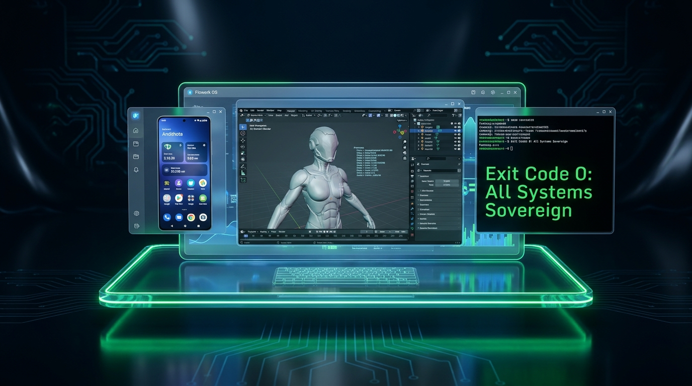
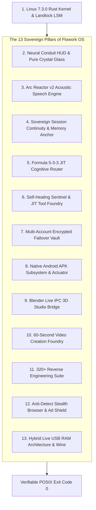

<!--
  Flowork OS: The Sovereign Autonomous AI Linux Operating System (Linux 7.3.0 Rust).
  Features built-in Mr. Flow autonomous AI agent, native Android APK runner, Blender 3D AI automation,
  60s video shorts creation foundry, 320+ reverse engineering tools, anti-detect browser, and Windows apps compatibility.
  100% Free, Private, Telemetry-Free, and Open Source.
-->

<h1 align="center">Autonomous AI Operating System (AI OS)</h1>

<b>The Open-Source Desktop AI Co-Pilot That Controls Your PC, Runs Android APKs, Automates Blender 3D, and Boots from USB</b>

<i>Powered by Flowork OS · 100% Free, Private, and Telemetry-Free Sovereign Desktop (Linux 7.3.0 Rust)</i>

  <a href="#-quick-test-drive-live-usb-in-5-minutes"><b>⚡ Try Live USB</b></a> ·
  <a href="#-why-flowork-os-the-real-problems-we-solve"><b>🎯 Why Flowork OS?</b></a> ·
  <a href="#-killer-superpowers-you-wont-find-in-any-other-os"><b>🚀 12 Superpowers</b></a> ·
  <a href="#%EF%B8%8F-architectural-overview-the-13-sovereign-pillars"><b>🏛️ 13 Pillars</b></a> ·
  <a href="#-sovereign-session-continuity-architecture-option-a--c"><b>⟲ Session Continuity</b></a> ·
  <a href="#-download-official-live-iso-v731"><b>📥 Download ISO</b></a> ·
  <a href="#%EF%B8%8F-productivity-shortcuts--neural-conduit-directives"><b>⌨️ Shortcuts</b></a> ·
  <a href="#-frequently-asked-questions-faq"><b>❓ FAQ</b></a>

---

> **“A Chatbot only gives you advice. Flowork OS actually does the work.”**  
> Instead of spending hours juggling terminal commands, broken Python environments, expensive cloud AI subscriptions, bloated emulators, and heavy operating systems, Flowork OS fuses an autonomous AI agent directly into your desktop environment with Landlock LSM kernel security and pure optical crystal glass interface telemetry.

---

## 🎯 Why Flowork OS? (The Real Problems We Solve)

| The Old, Frustrating Way | The Flowork OS Way |
| :--- | :--- |
| ❌ **Chatbots That Only Talk:** You ask a chatbot for code, copy it to your editor, get an error, paste it back, repeat 20 times. | ✅ **Autonomous Hands-On Execution:** Tell Mr. Flow *"Build this app"* or *"Fix my Wi-Fi"*. The AI creates files, executes terminal commands, inspects outputs, and self-corrects until it passes with **Exit Code 0**. |
| ❌ **Android Emulators Are Slow & Full of Ads:** Running Android apps on PC means installing 5GB emulators (BlueStacks, Nox) that lag your CPU and spam notifications. | ✅ **Native Android APK Subsystem & AI Control:** Run `.apk` files directly on your desktop with zero bloat. Plus, Mr. Flow can automate, tap, and control Android apps programmatically. |
| ❌ **3D Modeling & Animation Learning Curve:** Using Blender requires months of learning complex nodes, keyframes, and python scripts. | ✅ **AI-Driven 3D Studio (Blender Live):** Instruct Mr. Flow in plain language to model 3D assets, generate procedural geometry nodes, set up PBR materials, and render photo-real scenes. |
| ❌ **Context Lost on Restart:** Rebooting or closing the laptop erases the agent context, forcing you to start completely from scratch. | ✅ **Sovereign Session Continuity:** Atomic state anchors (`~/.flowork/session_state.json`) provide a smart boot continuity pill (`[ ⟲ Resume ] [ ✕ Fresh ]`) and quick switcher popover (`/resume`, `/sessions`) across reboots. |
| ❌ **Heavy & Janky Glass UI:** Blur and glass effects that consume 40% CPU and stutter when rendering animations. | ✅ **Pure Optical Crystal Glass HUD & Arc Reactor v2:** Vector dual-surface canvas with 28px hardware-accelerated blur, acoustic speech vibration sync, and <0.4% CPU footprint. |
| ❌ **Expensive AI Subscriptions & Rate Limits:** Paying $20–$100/month for cloud AI tools that cut you off mid-task when you hit a rate limit. | ✅ **Smart Multi-Account Failover:** Connect your free or developer keys once into a local encrypted vault. Flowork automatically rotates accounts on the fly so your tasks never stall. |
| ❌ **Manual Video & Content Production:** Creating animated educational videos or YouTube Shorts takes 3–4 hours of scripting, voiceover, keyframing, and rendering. | ✅ **1-Click Video Foundry:** Feed it any GitHub repository link or topic. In 60 seconds, Flowork generates the script, voiceover, animated stickman visuals, subtitles, and renders a 1080p video ready to upload. |
| ❌ **Windows App Lock-In:** Stuck on Windows because of specific `.exe` software (like FL Studio or specialized tools). | ✅ **Seamless Windows Apps & Drive Access:** Run Windows applications out of the box with pre-configured wine environments, and access all your existing Windows drives without formatting. |

---

## 🚀 Killer Superpowers You Won't Find in Any Other OS

### 1. 🤖 The Sovereign Autonomous Co-Pilot (Hands-On Execution & Self-Healing Sentinel)
* **The Pain:** Web-based AI chatbots (ChatGPT, Claude, Gemini Web) are confined inside a browser tab. They cannot create files on your hard drive, run tests, or touch your desktop applications. When code fails, you are stuck manually copying logs back and forth.
* **The Flowork Solution:** Mr. Flow has direct system and GUI actuation authority (`desktop_actuator`, `run_command`, `write_to_file`, `replace_file_content`):
  * **Self-Healing Sentinel:** If a build command or script throws an error, Mr. Flow automatically inspects the terminal traceback, surgically edits the target lines, and retries recursively until it passes with **Exit Code 0**.
  * **Dynamic Tool Foundry:** When confronted with a novel problem, Mr. Flow can synthesize, compile, and execute brand-new tools on the fly.
  * **Desktop Automation:** Interacts directly with windows, clicks buttons, and automates repetitive administrative desktop workflows.

### 2. 📱 Native Android Subsystem & AI App Control (`flowork-apk` & `apk-actuator`)
* **The Pain:** Running mobile apps on a PC usually requires installing heavy third-party emulators (BlueStacks, Nox, LDPlayer) that consume 6GB+ RAM, install unwanted sponsored apps, and run sluggishly. Moreover, there is no way for an AI agent to interact with them.
* **The Flowork Solution:**
  * **Run APKs Directly on Desktop:** Install, launch, and manage Android `.apk` packages natively via `flowork-apk` without virtualized emulator bloatware.
  * **AI App Automation (`apk-actuator`):** Mr. Flow can directly navigate and automate Android applications (TikTok, CapCut, Shopee, Instagram, etc.). He can tap UI elements, swipe, type inputs, extract mobile data, and execute mobile automation sequences completely hands-free.

### 3. 🎨 AI-Driven 3D Studio via Blender Live (`blender-live` & `blender-mastering`)
* **The Pain:** Creating 3D scenes, procedural meshes, character rigs, and photorealistic renders in Blender takes years of technical expertise. Doing it programmatically requires complex `bpy` Python scripting.
* **The Flowork Solution:**
  * **Live Blender IPC Bridge (`blender-live`):** Mr. Flow connects directly to Blender's runtime engine via a real-time command socket.
  * **Automated 3D Generation:** Simply ask Mr. Flow to build 3D environments, configure procedural geometry nodes, set up PBR materials, rig models, and trigger high-speed EEVEE or Cycles GPU hardware renders automatically.

### 4. 🎬 Automated 60-Second Video Creation Foundry (`githubtoyoutube`)
* **The Pain:** Turning open-source projects or educational topics into engaging short-form video content (YouTube Shorts, TikTok, Reels) normally takes 3 to 5 hours of scriptwriting, voice recording, asset sourcing, subtitle alignment, and rendering.
* **The Flowork Solution:**
  * Provide a single GitHub repository URL or topic name.
  * In under **60 seconds**, Flowork OS autonomously:
    1. Analyzes the codebase and crafts a viral, high-retention narration script.
    2. Synthesizes natural, human-quality voice narration.
    3. Procedurally animates stickman cartoon characters and explanatory UI cards frame-by-frame.
    4. Burns precise, word-by-word synchronized color subtitles.
    5. Masters and mixes background audio (`kamidi-mastering`).
    6. Hardware-encodes a vertical 1080x1920 MP4 via GPU NVENC acceleration.
    7. Produces an algorithmic SEO package (clickable titles, descriptions, hashtags, and a 12-tile contact sheet thumbnail).

### 5. ⟲ Sovereign Session Continuity & Memory Anchor (Option A & C Architecture)
* **The Pain:** When your computer restarts, updates, or recovers from a power event, traditional agent workspaces vanish. You lose your prompt history, current problem context, and debugging momentum.
* **The Flowork Solution:**
  * **Persistent Session State Anchor:** Automatically and atomically writes the active session metadata to `~/.flowork/session_state.json` on turn completion. Built with multi-layered safety (atomic temp write, crash recovery, 7-day TTL check, and timestamp validation).
  * **Smart Boot Continuity Pill (Option A):** On reboot or cold launch, an optical crystal glass pill is gracefully docked directly above the neural conduit bar:  
    `[ ⟲ Resume: "Neural Conduit Refactor" (14 turns) • 2m ago ] [ ✕ Fresh ]`  
    Single-click or hotkey instant resume, or dismiss for a pristine fresh conversation.
  * **Quick Session Switcher (Option C):** Slash commands `/resume` and `/sessions` summon a floating optical crystal popover listing past conversations with $\uparrow/\downarrow$ keyboard navigation, rapid `1-9` hotkeys, and relative timestamps.
  * **Cognitive Context Rehydration:** Resumed sessions immediately rehydrate past user queries and AI synaptic responses into the `MatrixQuantumConsole` buffer.

### 6. 💎 Pure Optical Crystal Glass HUD & Arc Reactor Engine v2
* **The Pain:** Most Linux desktop themes use flat CSS or heavy blur effects that drop frames, cause visual tearing, and provide zero feedback during AI background operations.
* **The Flowork Solution:**
  * **Dual-Surface Optical Ice Translucency:** 440x440 1:1 retina vector architecture with 28px hardware-accelerated blur, convex pills, concave control troughs, gradient white specular rims (0.16 to 0.05 opacity), razor matrix green (`#00ff66`), and electric cyan (`#00f2fe`).
  * **Acoustic Speech Vibration & Tempo Sync:** The Arc Reactor pulses and ripples in real-time acoustic frequency synchronization with voice synthesis and audio playback tempo.
  * **Agentic Tool Telemetry Reactor:** Real-time state indicators (Idle Orbit, Cognitive Synthesis, Actuator Pulse, Tool Execution Orbit, Self-Correction Surge) running at <0.4% CPU overhead.

### 7. 🪟 Windows Apps & Zero-Risk Drive Integration (`wine-staging` & NTFS Access)
* **The Pain:** Switching to a new OS often means losing access to your favorite Windows software or worrying about losing your existing Windows files.
* **The Flowork Solution:**
  * **Built-in Windows App Runtime:** Pre-tuned `wine-staging` environment ready to run `.exe` software and digital audio workstations (like FL Studio) out of the box with low-latency audio.
  * **Passwordless Windows Drive Access:** When running in Live USB mode, Flowork OS automatically detects and mounts your existing Windows NTFS and exFAT partitions. You can edit your Windows documents, copy files, and work on your projects without modifying your Windows installation.

### 8. ⚡ Zero-Setup & Unlimited Multi-Account AI (Free from Subscriptions & Limits)
* **The Pain:** Setting up open-source AI agents on Windows or Ubuntu requires hours of dependency debugging (conflicting Python wheels, CUDA version hell, Docker overhead). Meanwhile, paid SaaS subscriptions enforce strict hourly caps.
* **The Flowork Solution:**
  * **Instant Zero-Setup:** Boots ready to roll. Zero virtualenv creation, zero CUDA driver debugging.
  * **Multi-Account Failover Vault (`flowork-connector`):** Securely stores multiple free or developer API accounts in a local encrypted vault. Flowork monitors latency and rate limits, continuously prioritizing healthy accounts. When an account enters a cooldown window, it silently rotates to the next account, delivering uninterrupted, high-speed AI assistance without recurring monthly bills.

### 9. 🔬 320+ Tool Reverse Engineering & Anti-Detect Stealth Browser
* **The Pain:** Analyzing an Android application, inspecting a binary, or managing multiple web identities usually requires expensive anti-detect browsers ($50–$200/mo) and dozens of shady tools. Everyday browsing is constantly interrupted by unskippable video ads.
* **The Flowork Solution:**
  * **320+ Clean-Room Inspection Tools (`craft-anything`):** Instantly decompile APKs, inspect ELF/PE binaries, unpack Electron ASAR, and extract Unity/Unreal game assets.
  * **Hardware Fingerprint Spoofing (`flowork-stealth`):** Camoufox-powered engine spoofs WebGL, Canvas, system audio, and fonts at the OS level.
  * **100% Video Ad Eradication:** System-wide kernel DNS filter and browser blocker wipe out video ads on YouTube and Twitch completely.

### 10. 🧠 Formula 5-3-3 JIT Cognitive Router & Landlock LSM Sandboxing
* **The Pain:** Monolithic system prompts waste thousands of tokens per turn and cause cognitive drift. Meanwhile, AI agents running unconstrained scripts pose serious file system risks.
* **The Flowork Solution:**
  * **Native JIT Cognitive Routing (Formula 5-3-3):** Indexes 100+ specialized engineering triggers and skills without prompt bloat. Relevant capability instructions are dynamically injected only when active conditions require them.
  * **Landlock LSM Kernel Policies:** Linux kernel-level access restrictions in `/opt/floworkos/policies/` secure system invariants while allowing the agent full creative autonomy inside active workspaces.
  * **Zero Hardcoded Paths:** Universal system root at `/opt/floworkos` with dynamic `$HOME` resolution guarantees 100% portable, reproducible ISO builds.

### 11. ⏪ Flowork Neural Time-Machine (Instant CoW Rollback & `/undo`)
* **The Pain:** When an AI agent executes broad multi-file modifications or commands that cause unintended breakages, manually reverting code and hunting down deleted/created files is tedious and error-prone.
* **The Flowork Solution:**
  * **Pre-Turn Atomic Checkpointing:** `flowork_agent_runner` automatically triggers an atomic filesystem snapshot before every prompt in `<10ms` via `/opt/floworkos/bin/flowork-timemachine`.
  * **Hybrid Git & Hardlink CoW Engine:** Zero-byte shadow commits for git repositories and instant ext4 hardlinks for untracked workspace directories.
  * **Single-Command Rollback (`/undo`):** Reverts modified files, restores deleted files, and eradicates newly generated garbage files with a single keystroke.
  * **Interactive Visual Timeline (`/snapshots`):** Displays turn checkpoint history with timestamps and modified file counts directly on the pure crystal glass HUD.

### 12. 🎙️ Duplex Full-Voice Conductor (Hands-Free VAD & Sub-5ms Barge-In)
* **The Pain:** Conventional AI voice interfaces force you to wait until the AI finishes speaking before you can reply, and require slow cloud STT APIs that introduce 2-3 second response lag.
* **The Flowork Solution:**
  * **Sub-5ms Natural Barge-In:** Start talking or press Push-to-Talk (`Super + Shift + V` or right-click mic icon) to immediately silence Mr. Flow via `http://127.0.0.1:8998/barge_in`.
  * **Offline Faster-Whisper Model:** Pure offline `faster-whisper-tiny` (int8) running locally without cloud dependency or token cost.
  * **Energy-Based VAD & Acoustic HUD Sync:** Microphone input dynamically modulates the Arc Reactor visualizer with electric cyan (`#00f2fe`) acoustic ripples.
  * **Seamless Conduit Turn Injection:** Transcribed speech is automatically injected into `/tmp/flowork-neural-conduit-${USER}.sock` for hands-free execution.

---

## 🏛️ Architectural Overview: The 13 Sovereign Pillars

Flowork OS is architected around 13 deeply decoupled, sovereign subsystems engineered for stability, speed, and privacy:

---

## ⚡ Quick Test Drive (Live USB in 5 Minutes)

> [!TIP]
> **You do NOT need to wipe your hard drive or delete Windows/macOS!**  
> Flowork OS runs directly from a USB flash drive in **Live Mode**. Your existing files, Windows installation, and personal documents remain 100% untouched.

### 📥 3-Step Quick Start:

1. **Download the ISO Release Parts:**  
   👉 **[Download Flowork OS v7.3.1 ISO](https://github.com/flowork-os/AI-Operating-System-AI-OS-/releases)**

2. **Reassemble the ISO (1-Click):**
   * **Windows:** Put all parts in one folder and double-click `join-iso.bat`.
   * **Linux / Mac:** Run `bash join-iso.sh` in the terminal.

3. **Flash to USB Flashdrive (min 8 GB):**
   * **Linux CLI:** `sudo dd if=flowork-os-v7.3.1-amd64.iso of=/dev/sdX bs=4M oflag=direct conv=fsync status=progress`
   * **Windows / Mac:** Use **[Rufus](https://rufus.ie)** or **[BalenaEtcher](https://etcher.balena.io)**.
   * Select your USB drive and the reassembled `.iso` file, then click **Start**.
   * Restart your computer, press your boot key (`F12`, `F11`, or `Esc`), select your USB drive, and boot straight into Flowork OS!

---

## ⌨️ Productivity Shortcuts & Neural Conduit Directives

### System Shortcuts
| Shortcut | Action | Description |
| :--- | :--- | :--- |
| **`Super + Space`** | **Spotlight Search** | Instant application launcher and system command finder |
| **`Super + A` / `F4`** | **Sovereign Launchpad** | Visual card drawer showcasing all installed tools & creative apps |
| **`Super + Return`** | **Glass Terminal HUD** | Ultra-low latency translucent terminal HUD |
| **`Super` / `Alt + F1`**| **Start Menu** | Clean, searchable application menu |
| **Hover Right Edge** | **Mr. Flow AI Drawer** | Instant sidebar to give natural language instructions to your AI co-pilot |

### Neural Conduit Directives & Slash Commands
| Command | Action | Description |
| :--- | :--- | :--- |
| **`/resume`** or **`/sessions`** | **Quick Session Switcher** | Opens floating optical crystal popover to pick and resume previous sessions ($\uparrow/\downarrow$ or `1-9`) |
| **`/undo`** or **`/rollback`** | **Time-Machine Rollback** | Reverts workspace filesystem to the state immediately before the previous turn |
| **`/snapshots`** | **Time-Machine Timeline** | Displays recorded filesystem snapshot history and turn checkpoints |
| **`/listen`** or **`/voice`** | **Duplex Voice Capture** | Activates microphone voice recording with acoustic VAD and instant barge-in |
| **`/clear`** | **Clear Buffer** | Clears the neural conduit console display and starts a fresh visual workspace |
| **`/help`** | **Directive Help** | Displays immediate keyboard shortcut directives and conduit usage guidelines |
| **`Right-Click Mic`** | **Push-To-Talk** | Instant one-touch microphone speech input on the bottom conduit bar |
| **`Escape`** | **Dismiss Popover / Pill** | Instantly closes open session switcher popovers or continuity notifications |

---

## 💻 System Requirements

* **Processor:** 64-bit x86_64 CPU (Intel Core i3/i5/i7/i9 or AMD Ryzen).
* **RAM:** 4 GB minimum (8 GB+ recommended for heavy multitasking and local pipelines).
* **Storage:** 16 GB free space (only if you choose to install permanently; 0 GB needed for Live USB mode).
* **Boot Compatibility:** Compatible with **Legacy BIOS (MBR)** and **Modern UEFI (Secure Boot supported)**.

---

## ❓ Frequently Asked Questions (FAQ)

<b>Will booting Flowork OS erase my Windows files or personal photos?</b>

 
<b>No.</b> When you boot from the USB flash drive, Flowork OS runs entirely in RAM (Live Mode). It does not touch, modify, or format your internal hard drive unless you explicitly open the Calamares Installer and choose to install it.

<b>How does the Sovereign Session Continuity work across reboots?</b>

 
Flowork OS maintains an atomic session state anchor at <code>~/.flowork/session_state.json</code>. After completing a turn, the active session ID, title, turn count, and timestamp are safely recorded. Upon reboot, the neural conduit detects the anchor and offers an instant 1-click <b>[ ⟲ Resume ]</b> pill. You can also press <code>/resume</code> or <code>/sessions</code> anytime to switch between past conversations.

<b>Can I run my Android apps and Windows software on Flowork OS?</b>

 
<b>Yes.</b> Flowork OS features a native Android Subsystem (<code>flowork-apk</code>) to run and automate APKs without heavy emulators, as well as built-in Wine compatibility to run Windows <code>.exe</code> software directly.

<b>Do I need an expensive high-end NVIDIA GPU to run Mr. Flow?</b>

 
<b>No.</b> Flowork OS is engineered with ultra-lightweight native binaries. The system AI co-pilot connects seamlessly to lightweight endpoints or free API tiers via the Multi-Account Failover Vault without requiring an expensive graphics card.

<b>Is Flowork OS really 100% free and open source?</b>

 
<b>Yes.</b> Flowork OS is built entirely under open-source licenses (GPL-3.0 / MIT / Apache-2.0). There are zero paywalls, zero subscription tiers, and zero locked features.

---

**Flowork OS — The Autonomous Future of Personal Computing.**  
*Freedom, Privacy, and Built-In Intelligence.*

[**⭐ Star this repo on GitHub**](https://github.com/flowork-os/AI-Operating-System-AI-OS-) • [**💬 Join the Community**](https://github.com/flowork-os/AI-Operating-System-AI-OS-/discussions) • [**🐛 Report an Issue**](https://github.com/flowork-os/AI-Operating-System-AI-OS-/issues)

