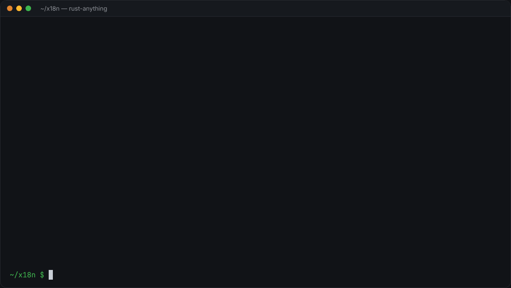

<p align="center">
  
</p>

<h1 align="center">rust-anything</h1>

<p align="center">제작: <a href="https://github.com/erkamyaman">erKam Yaman</a></p>

<p align="center"><a href="../README.md">English</a> · <a href="README_TR.md">Türkçe</a> · <a href="README_ZH.md">简体中文</a> · <a href="README_ZH-TW.md">繁體中文</a> · <a href="README_DE.md">Deutsch</a> · <a href="README_FR.md">Français</a> · <a href="README_RU.md">Русский</a> · <a href="README_UK.md">Українська</a> · <a href="README_JA.md">日本語</a> · 한국어 · <a href="README_AZ.md">Azərbaycanca</a> · <a href="README_UZ.md">Oʻzbekcha</a> · <a href="README_KK.md">Қазақша</a> · <a href="README_KY.md">Кыргызча</a> · <a href="README_TK.md">Türkmençe</a> · <a href="README_TT.md">Татарча</a> · <a href="README_UG.md">ئۇيغۇرچە</a> · <a href="README_PT.md">Português</a></p>

<p align="center"><sub>이 번역은 커뮤니티에서 관리하며 <a href="../README.md">영어 README</a>보다 늦게 반영될 수 있습니다.</sub></p>

<p align="center"><em>앱 전체를 Rust로 다시 작성하세요. 그 모든 과정 내내 앱은 계속 정상 작동합니다.</em></p>

<p align="center"><em>CLI, 서버, 라이브러리를 한 조각씩 옮기며, 매 단계마다 기존 구현과 동작을 대조 검증합니다.</em></p>

<p align="center">Node.js 및 TypeScript · Python · C · Go · Ruby · Java · PHP 및 C# 프리뷰 지원</p>

<p align="center">
  <a href="https://crates.io/crates/rust-anything"></a>
  <a href="https://www.npmjs.com/package/rust-anything"></a>
  
  <a href="#지원-에이전트"></a>
  <a href="https://github.com/erkamyaman/rust-anything/actions/workflows/ci.yml"></a>
  <a href="../LICENSE"></a>
  <a href="https://github.com/erkamyaman/rust-anything"></a>
</p>

<p align="center">최대 20배 더 빠르게 · 기록된 38,251개 케이스 재실행 · 불일치 0건 · 명령어 한 줄</p>

<p align="center">
  
</p>

**앱 전체를 한 번에 한 조각씩 Rust로 다시 작성하세요.** rust-anything은 현재 Node.js(TypeScript/JavaScript), Python, C, Go, Ruby 또는 Java 앱이 실제로 어떻게 동작하는지 기록(record)한 뒤, 다음 단계로 넘어가기 전에 Rust로 재작성된 각 조각을 해당 기록과 대조 검증하며 앱이 순수 Rust가 될 때까지 진행합니다. CLI, HTTP 서버, 라이브러리 모두 가능하며, 실제 Rust 코드는 코딩 에이전트(또는 개발자 본인)가 작성합니다. 기록에 포함된 범위만 잡아낼 수 있으므로 [잡아내지 못하는 부분](#잡아내지-못하는-부분)을 확인하세요. 느린 부분만 빠르게 만들고 싶다면 해당 핫 패스(hot path)만 한 번에 하나씩 포팅할 수도 있습니다:

| 실제 워크로드 (기존 구현과 동일한 결과) | 기존 구현 | rust-anything 적용 후 |
| --- | ---: | ---: |
| x18n 사이드바 검색, 50,000개 키 (TypeScript, Node) | 쿼리당 10 ms | **0.5 ms: 20배 향상** |
| 브라우저에서의 동일 검색 (wasm, 단일 스레드) | 10 ms | **0.95 ms: 11.5배** |
| 20,000개 문자열 `slugify` (Python) | 98 ms | **17배 향상** |
| Ruby 표준 라이브러리 `Shellwords.shellescape`, 50,000개 값 | 88 ms | **11.8배 향상** |
| 50,000개 문자열 `Slugify` (Go) | 49 ms | **4배 향상** |
| 50,000개 문자열 `slugify` (Java) | 43 ms | **3배 향상** |

4코어 환경에서 측정한 수치이며, 모든 수치에는 먼저 결과가 동일함을 검증하는 벤치마크가 [`demo/`](../demo)에 포함되어 있습니다. 작은 함수 하나를 호출할 때마다 Rust를 부르는 것은 보통 JIT보다 *더 느립니다*. rust-anything은 옮길 가치가 있는 루프를 찾아 그 루프 자체를 옮깁니다.

> rust-anything은 독립 프로젝트이며 Rust Project나 Rust Foundation과 제휴하거나 보증을 받지 않았습니다. "Rust"는 Rust Foundation의 상표입니다.

## 빠른 시작

아래 문구를 Claude Code, Codex, Cursor 또는 Gemini CLI에 붙여 넣어 에이전트가 설치하도록 하세요:

```text
rust-anything을 설치해 주세요: `cargo install rust-anything`을 실행한 다음 `rust-anything setup`을 실행하세요.
언제 다시 시작하면 되는지 알려 주세요.
```

직접 설치하려면 다음 명령어를 실행하세요:

```sh
cargo install rust-anything   # crates.io에서 설치
rust-anything setup           # Claude Code, Codex, Cursor, Gemini CLI에 등록
```

아직 Rust 툴체인이 없으신가요? macOS, Linux, Windows용 사전 빌드 바이너리가 각 [GitHub 릴리스](https://github.com/erkamyaman/rust-anything/releases)에 첨부되어 있으며, JavaScript 프로젝트의 경우 `npm install -g rust-anything`으로 동일한 바이너리를 설치할 수 있습니다.

Claude Code에서는 플러그인(MCP 서버 및 스킬 포함; 위 CLI가 `PATH`에 있어야 함)으로도 설치할 수 있습니다:

```text
/plugin install rust-anything --marketplace erkamyaman/rust-anything
```

`setup`은 탐지된 각 에이전트에 MCP 서버를 추가하고 에이전트가 스킬을 읽는 위치에 워크플로 스킬을 설치합니다. 기존 설정은 유지되며 여러 번 다시 실행해도 안전하고 `--remove`로 설정된 항목을 삭제할 수 있습니다(`setup`이 덮어써서 업데이트한 이전 값은 복원되지 않습니다). 그런 다음 에이전트에게 다음과 같이 요청해 보세요:

- *"rust-anything으로 이 CLI를 처음부터 끝까지 Rust로 다시 작성하고, 동일하게 동작하는지 증명해 줘."*
- *"이 검색이 느린 것 같아. rust-anything으로 프로파일링해서 핫 루프를 Rust로 옮겨 줘."*
- *"rust-anything으로 `src/parser/`의 Rust 마이그레이션 계획을 세우고, 첫 번째 유닛을 포팅해서 검증해 줘."*
- *"`rust/text-rs`의 Rust 포팅 버전을 기존 구현과 벤치마킹해서 배포해도 될지 알려 줘."*

### 지원 에이전트

| 에이전트 | `rust-anything setup`이 추가하는 항목 |
| --- | --- |
| Claude Code | `~/.claude.json`의 MCP 서버, `~/.claude/skills/`의 스킬 |
| Codex | `~/.codex/config.toml`의 MCP 서버, `~/.codex/skills/`의 스킬 |
| Cursor | `~/.cursor/mcp.json`의 MCP 서버 |
| Gemini CLI | `~/.gemini/settings.json`의 MCP 서버 |
| 기타 MCP 클라이언트 | `rust-anything mcp`를 stdio 서버로 직접 추가 ([설치](#설치) 참고) |

기존 파일을 수정하기 전에 `setup`은 같은 위치에 백업 복사본(`<file>.rust-anything.bak`)을 저장합니다.

각 단계를 직접 실행할 수도 있습니다:

<p align="center">
  
</p>

```sh
rust-anything profile . -- node bench.mjs              # 어디가 병목이고 누가 호출하는지 확인
rust-anything bridge . src/fuzzy.ts --batch fuzzyScore:text
# src/port.rs 작성 (또는 에이전트에게 맡기기), 그다음 실행:
rust-anything record rust/fuzzy-rs && rust-anything build rust/fuzzy-rs
rust-anything diff rust/fuzzy-rs                       # 기록된 모든 케이스가 일치해야 함
rust-anything bench rust/fuzzy-rs                      # 더 빠른가? 판정 결과가 알려줌
rust-anything gate rust/fuzzy-rs                       # 이 게이트를 통과해야 완료
```

rust-anything은 코드를 자동 번역하지 않습니다. Rust 코드는 코딩 에이전트(Claude Code, Codex, Cursor 등)나 개발자 본인이 작성합니다. rust-anything이 제공하는 것은 에이전트가 감으로 맞히기 어려운 요소들입니다. 즉, 시간이 어디서 쓰이는지, 무엇을 어떤 순서로 먼저 포팅할지, 나머지 코드가 API 변경 없이 Rust를 호출할 수 있는 브리지, 포팅이 반드시 맞춰야 하는 정확한 동작, 안전한 배포 방법, 그리고 포팅 완료 여부를 판정하는 게이트를 제공합니다.

## 지원 언어

| 언어 | 유닛 | 브리지 | 기록 및 재실행 방식 |
| --- | --- | --- | --- |
| TypeScript/JavaScript | 폴더 또는 파일 | 생성된 바이너리 와이어를 사용하는 napi-rs 또는 wasm-bindgen; 클래스 및 async 포함 | Node가 `.ts` 소스를 직접 실행 |
| Python | 패키지 또는 모듈 | PyO3(abi3), 직접 변환, 타입이 지정된 예외 | Python이 기존 모듈을 import |
| C | `.c` 파일 | 기존 이름과 동일한 `extern "C"` 함수 및 헤더 | 기존 코드를 공유 라이브러리로 컴파일해 ctypes로 호출, 케이스마다 fork |
| Go | 패키지 | 기존 API를 유지하는 패키지 내의 타입 지정 cgo 호출 및 생성된 바이너리 와이어 | 별도 모듈로 빌드된 생성 Go 드라이버 |
| Ruby | 모듈 함수가 담긴 파일 또는 폴더 | 기존 모듈 하위의 magnus 확장 | 생성된 Ruby 드라이버 |
| Java | `public static` 메서드가 담긴 패키지 | 기존 메서드를 유지하는 래퍼 클래스 내의 타입 지정 JNI 및 생성된 바이너리 와이어 | 생성된 리플렉션 드라이버 |
| PHP (프리뷰) | 함수 및 `public static` 메서드가 담긴 폴더 | 향후 지원 예정: C ABI 기반 PHP FFI | 현재 전체 앱 지원: CLI 및 서버(`php -S`)용 `app record`, `app replay`, 프론트 도어 |
| C# (프리뷰) | `public static` 메서드가 담긴 폴더 | 향후 지원 예정: C ABI 기반 P/Invoke | 현재 전체 앱 지원: CLI 및 ASP.NET 서버(`dotnet <app>.dll`)용 `app record`, `app replay`, 프론트 도어 |

C를 제외한 모든 언어는 배치 클래스(`--batch`)도 지원합니다. 항목들이 한 번만 경계를 넘어 Rust 내부에 머무르며, 각 호출마다 모든 코어에서 전체 항목을 처리합니다.

언어는 저장소 파일(`go.mod`, `pom.xml`, `.csproj` 또는 `.sln`, `pyproject.toml`, `Gemfile`, `composer.json`, `package.json`, 그 외에는 가장 많은 소스 파일)로부터 자동 감지되며 `--lang`으로 재정의할 수 있습니다. 타입 정보는 소스에서 추출합니다(TS 타입, Python 힌트, C/Go/Java/C# 시그니처, Ruby YARD 태그, PHP 타입 및 phpdoc). 타입이 없는 매개변수라도 숫자로 사용되면 숫자로 추론됩니다.

PHP는 프리뷰 상태입니다. `analyze`로 PHP 앱을 계획할 수 있고(Composer 패키지 및 PSR-4 오토로딩, 느슨한 비교나 정수의 float 오버플로 같은 위험 요소, Composer 패키지의 crate 매핑), PHP CLI나 서버를 기록·재실행하고 Rust 프론트 도어 뒤에 둘 수 있습니다. PHP FFI를 통해 유닛을 Rust로 포팅하는 작업이 다음 단계입니다([이슈 #2](https://github.com/erkamyaman/rust-anything/issues/2)).

C#도 같은 방식으로 프리뷰 지원됩니다. `analyze`가 `.csproj` 프로젝트와 NuGet 패키지(crate로 매핑)를 읽고 `using` 지시문을 폴더로 해석하며, C#의 고유한 동작 차이(`decimal`, `dynamic`, LINQ 지연 쿼리, `Task`, `lock`, 리플렉션)를 표시합니다. C# CLI나 ASP.NET 서버를 기록·재실행하고 Rust 프론트 도어 뒤에 둘 수 있으며, P/Invoke를 통한 유닛 포팅이 다음으로 지원될 예정입니다.

## 작동 방식

```
profile ──> analyze ──> bridge ──> record ──> port.rs ──> diff ──> bench ──> shadow ──> gate
 시간이      무엇을      Rust       기존 코드가  개발자나     모든      더 빠른가?  프로덕션    통과하면
 쓰이는 곳   먼저 옮길지 crate와    실제로      에이전트가   기록      판정 결과   병행 실행   완료
                         래퍼 생성  하는 동작   직접 작성    케이스
```

기존 코드는 항상 진실의 원천(source of truth)으로 남습니다. `record`는 엣지 케이스(및 사용자가 지정한 입력)로 기존 코드를 실행해 반환값이나 예외를 저장하고, `diff`는 모든 케이스를 Rust 구현에 대해 재실행합니다. 전부 일치하고 `gate`를 통과하기 전에는 아무것도 배포되지 않습니다. 호출 측 코드는 전 과정에서 기존 API를 그대로 유지합니다.

전체 앱 역시 전체 프로그램을 검증하는 틀 안에서 유닛 단위로 동일한 루프를 거칩니다([전체 앱 포팅하기](#전체-앱-포팅하기)):

```
analyze --whole-app ──> app record ──> app front-door ──> 유닛별: 위 루프 수행 후 app wire ──> app lift
 구조, 모든 의존성,      외부에서 본     Rust가 진입점       gate 통과 시 해당 유닛은 Rust가       순수 Rust,
 내려야 할 결정 사항     앱의 동작       소유; 나머지는      응답: 재실행 100%, 폴백 비율 감소      재실행으로
                                         기존 앱이 응답                                          동작 증명
```

## 핵심 루프

| 단계 | 명령어 | 하는 일 |
| --- | --- | --- |
| 0. 프로파일링 | `rust-anything profile <repo> -- node bench.mjs` | 언어별 프로파일러(node, cProfile, `go test` pprof, JFR, Ruby 트레이서) 아래에서 실제 워크로드를 실행해 포함 시간(inclusive time) 기준 핫 함수, 호출자, 배치화할 루프를 찾고, 이미 컴파일된 코드(numba, Cython, JAX)처럼 Rust 이점이 적은 코드를 표시 |
| 1. 계획 | `rust-anything analyze <repo>` | 유닛, 포팅 순서, `file:line` 기반 위험 요소, 유닛별 브리지, 의존성-crate 적합도, 가장 좋은 첫 포팅 대상을 분석. `--whole-app`은 진입점과 앱 구조, import 또는 선언된 모든 의존성과 그 crate, 조각(서로 import하는 유닛은 함께 이동), 권장 답안이 포함된 번호 매긴 결정 목록을 추가 |
| 2. 브리지 | `rust-anything bridge <repo> <unit>` | 바인딩(`lib.rs`와 소스 언어가 로드하는 래퍼) 및 포팅할 스텁(`port.rs`)이 담긴 crate를 생성. `--batch fn:param`은 여러 `param` 값을 Rust에 보관하는 클래스를 추가 |
| 3. 기록 | `rust-anything record <crate>` | 생성된 엣지 케이스(비ASCII, 이모지, `-0`, `NaN`, float 자리에 들어온 int 등)와 각 매개변수의 모든 시맨틱 함정(문자열 길이와 대소문자, 부호 있는 나눗셈, 오버플로 경계, float 출력, map 및 정렬 순서)으로 기존 구현을 실행하고 `cases.jsonl`에 저장. 수치 계산 코드는 `--float-tolerance 1e-9`로 해당 비율 오차 내 일치를 허용 |
| 3. 빌드 | `rust-anything build <crate>` | Rust 측 결과물(`.node`, wasm 패키지, Python 확장 또는 공유 라이브러리)을 빌드 |
| 3. 비교 | `rust-anything diff <crate>` | 기록된 케이스를 기존 호출자가 호출하는 방식 그대로 Rust에 재실행하고 불일치 목록을 출력 |
| 3. 벤치마크 | `rust-anything bench <crate>` | 브리지 비용을 포함해 기존 구현과 Rust 구현에서 기록된 케이스 실행 시간을 측정 |
| 4. 섀도 | `rust-anything shadow <crate>` | 양쪽을 모두 실행하고 기존 구현의 결과를 반환하며 불일치를 보고하는 드롭인 모듈. `RUST_ANYTHING_MODE=old\|shadow\|new`로 제어 |
| 5. 게이트 | `rust-anything gate <crate>` | fmt, clippy `-D warnings`, 테스트, `unsafe` 감사, 미포팅 항목 없음, 기존 구현의 모든 오류 경로에 대한 실패 케이스 기록, 기존 구현이 오류를 반환하는 곳에서 `unwrap`/`expect`/`panic!` 금지(`// INFALLIBLE: <이유>` 표시 제외), 빌드, API, 동작 검증 |
| 에이전트 | `rust-anything setup` | 코딩 에이전트에 MCP 서버(`rust-anything mcp`, 모든 단계를 도구로 제공)와 워크플로 스킬([`skills/rust-anything/SKILL.md`](../skills/rust-anything/SKILL.md))을 등록 |

## 전체 앱 포팅하기

목표는 기존 구현과 똑같이 동작하는 순수 Rust 앱을 만드는 것이며, 기존 구현은 기준(reference)으로 유지됩니다. 에이전트가 Rust 코드를 작성하고, rust-anything은 작업 순서를 정하고, 스캐폴딩을 생성하고, 모든 단계를 증명합니다. [전체 앱 스킬](../skills/rust-anything/whole-app.md)은 오직 개발자만 내릴 수 있는 결정부터 시작해 에이전트가 전체 과정을 진행하도록 안내합니다:

- **그릴링(Grilling)**: 에이전트가 포팅이 의존하는 모든 결정이 확정될 때까지 권장 답안과 함께 여러 라운드로 질문한 뒤, 각 결정을 `rust/DECISIONS.md`에 ADR로 기록하고 기존 용어와 Rust 이름을 매핑하는 `rust/GLOSSARY.md`를 작성합니다.
- **리서치(Research)**: 백그라운드 에이전트가 각 의존성의 1차 소스를 읽고, 발견한 모든 시맨틱 함정을 담아 `rust/research/<topic>.md`를 작성합니다.
- **세션 간 이어달리기**: `rust/MAP.md`에 모든 유닛의 상태가 나열됩니다. 세션은 시작 전 유닛 하나를 맡고, 각 체크포인트마다 다음 세션을 위해 `rust/HANDOFF.md`를 남깁니다. 한 웨이브(wave) 내의 유닛들은 서브에이전트가 병렬로 포팅할 수 있습니다.
- **컷오버(Cutover)**: 에이전트가 할 수 있는 작업을 마친 뒤, 오직 사용자만 수행할 수 있는 단계(배포, DNS, 시크릿)와 각 단계의 롤백 방법을 담은 대화형 스크립트 `rust/cutover.sh`를 작성합니다.

그릴링, 리서치 및 이러한 기법들은 [Matt Pocock의 skills](https://github.com/mattpocock/skills)에서 차용했습니다.

먼저 계획을 세우세요. `rust-anything analyze . --whole-app`은 앱의 형태(CLI, 서버, 라이브러리)와 진입점, import 또는 선언된 모든 외부 의존성과 해당 Rust crate 및 적합도, 조각 단위의 포팅 순서(서로 import하는 유닛은 함께 이동), 그리고 권장 답안이 포함된 번호 매긴 결정 사항(유지할 유닛, 차단된 유닛, 대체 crate가 없거나 일부만 있는 의존성)을 제공합니다.

그런 다음 외부에서 전체 프로그램을 증명합니다. `record`와 `diff`가 하나의 유닛을 증명한다면, `app record`와 `app replay`는 6개 언어 중 하나로 작성된 CLI 및 서버 앱 전체를 블랙박스로 증명합니다:

```sh
rust-anything app record . -- python3 cli.py          # 기존 앱을 실행하는 명령어
rust-anything app replay .                            # 기존 앱은 반드시 100% 통과해야 함
rust-anything app replay . --build "target/release/mytool"
```

- `app record`는 앱 자체 문서의 예제(Markdown 및 셸 파일 속 `$ mytool ...` 줄과 거기서 언급된 파일), `--inputs` JSONL 파일(`{"name", "args", "stdin", "env", "files"}`), 그리고 해당 케이스들에서 도출한 시맨틱 함정(비ASCII 및 이모지 문자열, 음수 나눗셈 및 나머지, 오버플로, 매우 크거나 작은 float, map 순서, 누락된 파일)으로 기존 앱을 실행합니다. 각 케이스는 두 번 실행되며, 두 실행 사이에 달라지는 부분은 `[..]` 와일드카드가 됩니다. `--normalize timestamps|uuids|key-order` 또는 `--normalize name=regex`로 정규화 규칙을 추가해 케이스와 함께 저장할 수 있습니다.
- 케이스는 `rust/app-cases/`에 [trycmd](https://docs.rs/trycmd) 파일 형태로 저장됩니다: `<case>.toml`(argv, env, 종료 코드), `.stdin`, `.stdout`, `.stderr`, `.in/`(입력 파일), `.out/`(기록된 파일). 직접 읽고 수정할 수 있으며, 포팅된 바이너리가 생기면 Rust 테스트에서 `trycmd`로 바로 실행할 수 있습니다.
- `app replay`는 모든 빌드를 이 케이스들에 대해 실행하고 `passed/total`을 출력하며, 실패한 케이스별 diff를 `rust/app-cases/replay-report.md`에 기록하고 불일치가 하나라도 있으면 0이 아닌 코드로 종료합니다. 아래 프론트 도어처럼 `RUST_ANYTHING_FALLBACK_LOG`가 가리키는 파일에 로그를 추가(기존 구현으로 폴백할 때마다 한 줄 기록)하는 빌드라면 폴백 비율도 함께 보고됩니다.
- `app replay --case <name>`은 리포트에 나온 이름으로 특정 케이스 하나만 다시 실행합니다. 전체를 다시 실행하기 전에 불일치를 빠르게 고치는 반복 루프용입니다.

그다음 진입점을 Rust로 옮기고 한 유닛씩 명령을 넘겨줍니다:

```sh
rust-anything app front-door .                            # rust/app: 모든 명령이 기존 앱을 실행
rust-anything app wire . textkit --command upper          # textkit-rs가 gate를 통과한 뒤 연결
# rust/app/src/units/textkit.rs에 글루 코드를 작성한 후:
rust-anything app wire . textkit                          # 다시 100% 통과, 폴백 비율 감소
```

- `app front-door`는 앱 이름으로 된 Rust 바이너리 `rust/app`의 스캐폴딩을 생성합니다. 기록된 케이스의 명령과 플래그를 파싱하는 clap 파서로, 모든 명령을 동일한 argv, stdin, 환경 변수로 기존 앱에 넘겨 실행하고 출력과 종료 코드를 그대로 전달합니다. 모든 폴백이 집계되므로, 갓 생성된 프론트 도어를 재실행하면 100% 통과에 100% 폴백이 나옵니다(이를 보여주기 위해 빌드와 재실행을 수행합니다). `rust/app`은 절대 덮어쓰지 않으므로 이후부터는 온전히 개발자의 코드가 됩니다.
- `app wire <repo> <unit> --command <name>`은 해당 유닛 crate에 `gate`를 실행하고(방금 통과했다면 `--skip-gate`), `rust/app`에 라이브러리로 추가하며, 개발자나 에이전트가 채워 넣을 수 있도록 `src/units/<unit>.rs`를 최초 1회 생성한 뒤(인자 파싱, `<crate>::port` 호출, 기존 앱과 동일한 출력 인쇄), 명령을 이 유닛으로 라우팅하고 빌드 및 재실행합니다. 최종 lift 전까지는 `RUST_ANYTHING_UNIT_<NAME>=original`로 연결된 유닛을 다시 기존 앱으로 보낼 수 있습니다.

인자가 없거나, 알 수 없는 명령이거나, 사용법 오류처럼 특정 명령 이름이 없는 argv에 대해서는 앱 자체 이름을 명령으로 연결하세요(`--command mytool`).

폴백 비율이 0인 상태로 재실행을 통과하고 모든 유닛이 gate를 통과하면 순수 Rust 앱으로 완성합니다:

```sh
rust-anything app lift .
```

- `app lift`는 두 조건이 모두 충족될 때까지 실행을 거부하며, 무엇이 가로막고 있는지(여전히 폴백 중인 케이스, 아직 스텁 상태인 글루 코드, gate를 실패한 유닛)를 알려줍니다.
- 먼저 복사본에서 작업을 수행하여 폴백 경로와 킬 스위치를 제거하고, 각 유닛 crate를 `rust/app`의 일반 라이브러리로 전환하며(`cdylib`, 바인딩, 생성된 래퍼 제거), `cargo test` 시 `trycmd`로 `rust/app-cases`를 실행하는 `rust/app/tests/app_cases.rs`를 추가해 CI에서 cargo 외에 아무것도 필요하지 않게 만듭니다.
- 그런 다음 lift 체크리스트를 실행합니다: 모든 유닛과 `rust/app`에 대한 fmt, clippy `-D warnings`, 테스트 실행, 설치된 환경에서 `rust/DECISIONS.md`에 명시된 모든 타겟 빌드 또는 검사, 런타임에 읽는 파일과 임베드되지 않은 애셋 폴더 확인, 순수 바이너리에 대한 재실행 검증. 이 모든 것이 통과한 경우에만 변경 사항이 반영됩니다. 원본 코드는 전혀 건드리지 않습니다.

### 서버

동일한 명령어들로 HTTP 서버도 검증할 수 있습니다. `--http`는 해당 명령이 서버를 시작함을 알리며, 포트는 `PORT` 환경 변수나 명령 내 `{port}`에서 가져옵니다(항상 같은 포트에서 수신 대기하는 서버라면 `--port` 사용):

```sh
rust-anything app record . --http -- node server.js
rust-anything app replay .
rust-anything app front-door .                                    # axum: 모든 라우트를 프록시
rust-anything app wire . api --route 'GET /users/{id}' --route '*'
rust-anything app lift .
```

- 요청은 앱 문서의 `curl` 줄(`curl -X POST -d ... http://localhost:8080/x`), `--inputs`(`{"name", "method", "path", "headers", "body"}`), 그리고 함정 입력에서 가져옵니다. 경로 세그먼트와 쿼리 값은 CLI 인자와 동일한 함정 값으로 치환되고, 본문은 텍스트 및 JSON 함정으로 치환되며, 알 수 없는 라우트 요청도 포함됩니다. 각 실행마다 서버를 새로 시작하고 이름순으로 요청을 보내므로 요청 간 상태가 유지됩니다.
- 케이스는 `rust/app-cases/http/<case>.toml`(요청, 상태 코드, 중요한 헤더)과 `<case>.body`(응답 본문, 두 실행에서 달랐던 부분은 `[..]` 처리)로 저장됩니다. `Date`, `Server` 등 매 응답마다 달라지는 헤더는 제외되며, 신경 쓰지 않는 헤더 줄은 지우셔도 됩니다.
- 프론트 도어는 기존 서버를 별도 포트에서 띄우고 어떤 유닛도 응답하지 않는 모든 라우트를 프록시하는 axum 서버입니다. `wire --route`는 axum 라우트 형식(`METHOD /path/{param}`, 모든 메서드에 대해 `/path`, 그 외 전체에 대해 `*`)을 받으며, 글루 함수에는 라우트, 매개변수, 요청이 전달됩니다. `lift`는 프록시를 제거하며, 이후 HTTP 케이스는 CI에서 `app replay`로 실행됩니다.

### 라이브러리

라이브러리는 재실행할 프로세스가 없으므로 공개 API 자체가 프론트 도어가 되며, 각 유닛의 기록된 케이스가 증명이 됩니다.

```sh
rust-anything app front-door .        # rust/app: 공개 API를 갖춘 Rust crate
# 각 유닛마다 루프 진행: bridge, record, port.rs, build, diff, gate; 그다음:
rust-anything app wire . textkit-rs   # rust/app에서 re-export; 기존 코드는 섀도를 import
rust-anything app replay .            # 연결된 모든 유닛의 케이스 실행; 폴백 = 아직 기존 코드에 남아 있는 export 비율
rust-anything app lift .
```

- 저장소에 `main`도 서버도 없는 경우(그렇지 않다면 `--library` 지정) `app front-door`가 공개 API(모든 유닛의 export)를 찾아 `rust/app`을 라이브러리 crate로 스캐폴딩합니다. 연결된 각 유닛은 그 안의 모듈(`pub use textkit_rs::port as textkit;`)이 됩니다.
- `app wire`는 `bridge`로 만든 crate를 받아 `gate`를 실행하고 유닛의 섀도 드롭인 모듈을 작성합니다. 기존 패키지가 해당 유닛 대신 이 섀도를 import하므로 호출자는 기존 API를 유지한 채 Rust 구현에 도달합니다. `RUST_ANYTHING_UNIT_<NAME>=original`을 설정하면 해당 유닛을 기존 구현으로 되돌립니다(C의 경우 섀도 플래그 없이 빌드).
- `app replay`는 연결된 모든 유닛의 기록된 케이스를 바인딩을 통해 실행합니다. 폴백 비율은 아직 Rust가 응답하지 않는 공개 export의 비율(연결되지 않은 유닛 및 `bridge`가 기존 언어에 남겨둔 export)입니다.
- `app lift`는 폴백 0 및 모든 유닛의 `gate` 통과가 필요하며, 유닛에서 바인딩, 래퍼, 섀도를 제거해 `rust/app`을 하나의 순수 Rust 라이브러리로 남깁니다. `port.rs` 파일은 전혀 건드리지 않으므로 바인딩을 통해 일치했던 케이스들이 그대로 유효하며, 체크리스트는 여전히 섀도를 import하고 있는 기존 코드 파일을 경고로 알려줍니다.

다섯 가지 모두 MCP 도구(`app_record`, `app_replay`, `app_front_door`, `app_wire`, `app_lift`)로도 제공됩니다.

## 사례 연구: x18n의 코어

API 변경 없이 옮길 수 있는 x18n 코어의 29개 함수 전부를 rust-anything으로 포팅했습니다. 모든 gate를 통과했고 7,925개의 기록된 케이스가 정확히 일치했습니다. 그러나 이어진 `rust-anything bench` 결과, JS에서 호출할 때 브리지 비용이 실제 작업 비용보다 크기 때문에 이 포팅들이 기존 TS보다 더 느린 것으로 나타났습니다. 전체 보고서: [`demo/x18n-core`](../demo/x18n-core/README.md). 여기서 얻은 교훈은 도구 자체에 녹아 있습니다. 포팅을 배포하기 전에 반드시 `bench`로 측정하세요.

## 핫 패스: 데이터를 Rust 안에 유지하기

항목 하나마다 한 번씩 포팅 함수를 호출하면 항목마다 브리지 비용을 지불해 JIT에 집니다. 이기는 방법은 루프를 통째로 옮기는 것입니다. `profile`이 그 루프를 찾고, `--batch`는 항목들을 한 번만 받아 호출당 모든 코어에서 전체 항목에 함수를 실행한 뒤 타입 배열 결과를 반환하는 클래스를 생성합니다.

```sh
rust-anything profile ../x18n -- node --experimental-strip-types $PWD/demo/x18n-search/search.ts .
# -> fuzzyScore: 전체 실행 시간의 1/4을 차지하며 `matched`가 키마다 호출함 -> 배치 처리 대상
rust-anything bridge ../x18n packages/core/src/fuzzy.ts --batch fuzzyScore:text
```

```js
const search = new FuzzyScoreBatch(keys)          // 최초 1회 초기화
const order = search.rank(query, 0)               // 키 입력마다 호출: 최상위 매칭 순 인덱스 배열
```

`port.rs`의 `FuzzyScoreIndex` 구조체는 기본 루프를 대체해 항목을 한 번만 전처리하고 자체적으로 순위를 매깁니다(`rank`). 각 키를 소문자로 변환해 문자 마스크와 함께 보관하고, 각 키에서 자주 쓰이는 모든 문자의 첫 위치를 담은 테이블(한 글자 쿼리는 열 하나만 조회)과 직전 쿼리의 매칭 결과를 저장합니다(`s` 다음에 `se`를 입력하면 `s`에 매칭된 것만 다시 채점). 50,000개 키에 대해 글자 하나씩 입력하는 x18n 사이드바 검색에서 결과는 완전히 동일합니다:

| 방식 | 쿼리당 시간 | TS 대비 |
| --- | ---: | ---: |
| TS: `map(fuzzyScore)`, 필터, 정렬 | 10 ms | 1x |
| 인덱스와 동일한 축소(narrowing)를 적용한 TS | 4.1-5.4 ms | 2x |
| 동일한 포팅, 키별 개별 호출 | - | 0.2-0.4x |
| `FuzzyScoreBatch`, 기본 인덱스 (4코어) | 5.1 ms | 1.7x |
| `FuzzyScoreIndex`를 적용한 `FuzzyScoreBatch` (napi, 4코어) | 0.45-0.56 ms | **18-22x** |
| 동일 구현의 wasm 버전 (단일 스레드) | 0.95 ms | **11.5x** |

동일한 축소 기법을 쓰는 TS와 비교해도 Rust가 여전히 7~12배(wasm은 5배) 빠릅니다. 반환된 인덱스를 키로 바꿀 때는 일반 루프를 사용하세요. `Array.from(order, i => keys[i])`는 0.4 ms로 20배 더 많은 시간이 걸렸습니다.

모든 언어에서 배치가 지원되며, 건별 호출 포팅이 지는 경우에도 배치는 기존 구현을 앞섭니다. 4코어에서 동일한 작업, 동일한 결과 및 오류 기준입니다(각 데모 폴더에 벤치마크 포함):

| 언어 | 워크로드 | 기존 구현 | 건별 호출 포팅 vs 기존 | 배치 vs 기존 |
| --- | --- | ---: | ---: | ---: |
| TS | x18n 검색, 50,000개 키 | 10 ms | 0.2-0.4x | **20x** |
| Python | `slugify`, 20,000개 문자열 | 98 ms | - | **17x** |
| Ruby | `slugify`, 20,000개 문자열 | 110 ms | - | **12.7x** |
| Ruby | `shellescape` (표준 라이브러리), 50,000개 혼합 값 | 88 ms | - | **11.8x** |
| Go | `Slugify`, 50,000개 문자열 | 49 ms | 0.93x | **4x** |
| Java | `slugify`, 50,000개 문자열 | 43 ms | 0.68x | **3x** |

컴파일 언어 기반의 기존 구현은 항목당 작업이 이미 빠르기 때문에 코어 수만큼 배치가 이득을 얻는 형태라 향상 폭이 작습니다. 배치 crate는 `mimalloc`으로 메모리를 할당합니다. 시스템 할당자를 썼을 때 Go 배치는 단일 스레드보다도 느렸습니다. 데모: [`demo/x18n-search`](../demo/x18n-search/README.md).

## 6개 언어의 실제 코드 검증

Go의 `path`, Ruby의 `shellwords`, Python의 `colorsys`, 그리고 얇은 파사드 뒤의 JDK 및 glibc 동작까지 모두 gate를 통과했으며 총 13,010개의 케이스가 기록되었습니다. 이 실행 과정에서 rust-anything 자체의 버그(`serde_json`을 거치며 float이 1 ULP 어긋나는 문제, 기록 중 C 크래시, 타입 없는 코드에 쓰레기 입력이 들어가는 문제)도 찾아 수정했습니다. 함수당 호출 시 Ruby 포팅은 Ruby보다 4.4배, Python 포팅은 CPython보다 1.35배 빨랐고, Go와 Java의 리프 함수는 기존 언어가 더 빨랐습니다. 배치로 실행하면 모든 언어가 승리합니다(위 표 참고). 보고서: [`docs/real-world-languages.md`](./real-world-languages.md).

## 예제: x18n의 실제 모듈

[x18n](https://github.com/x18n-dev/x18n)의 `packages/core/src/fuzzy.ts`를 [`demo/`](../demo)에 두 가지 방식으로 포팅했습니다:

```sh
rust-anything analyze ../x18n                                      # fuzzy.ts: 준비됨, wasm-bindgen (core는 브라우저에서 실행)
rust-anything bridge ../x18n packages/core/src/fuzzy.ts --out demo/fuzzy-rs
rust-anything record demo/fuzzy-rs --count 2000
# src/port.rs 작성
rust-anything gate demo/fuzzy-rs
```

Rust `char` 단위로 인덱싱한 첫 번째 포팅은 간단한 테스트는 통과했지만 `diff`에서 실패했습니다:

```
198/200 cases match
- fuzzyScore("b😀", "a😀b😀c"): expected {"ok":1997}, got {"ok":1998}
```

JS의 `indexOf`는 UTF-16 코드 단위로 세기 때문에 이모지 하나가 두 자리를 차지합니다. `demo/*/src/port.rs`의 포팅은 생성된 `utf16` 헬퍼를 사용해 napi-rs(`demo/fuzzy-napi`)와 wasm-bindgen(`demo/fuzzy-rs`) 모두에서 2000/2000개 케이스와 gate를 통과했습니다.

rust-anything이 x18n 전체에 대해 작성한 계획: [`docs/examples/x18n.md`](./examples/x18n.md).

## 설치

```sh
cargo install --path .
```

`record`, `diff`, `bench`는 기존 코드를 해당 언어의 실제 런타임에서 실행합니다: TS는 Node 22.6+(`.ts` 소스를 직접 실행), Python과 C(ctypes)는 Python 3.9+, Go 1.21+, Ruby 3+, JDK 17+(`javac` 및 `java`)이 필요합니다. C는 C 컴파일러도 필요합니다. wasm 브리지는 추가로 `rustup target add wasm32-unknown-unknown`과 `cargo install wasm-bindgen-cli --version <crate의 wasm-bindgen 버전> --locked`가 필요하며, `build`가 정확한 버전을 안내해 줍니다.

에이전트용으로는 `rust-anything setup`이 모든 것을 등록합니다(빠른 시작 참고). 대신 단일 프로젝트에만 MCP 서버를 수동으로 추가하려면 `.mcp.json`에 다음을 넣으세요:

```json
{ "mcpServers": { "rust-anything": { "command": "rust-anything", "args": ["mcp"] } } }
```

## `bridge`가 결정하는 사항

- 브리지를 건널 수 없는 export는 이유와 함께 소스 언어에 남고, 섀도 모듈이 기존 구현을 re-export합니다. TS의 경우: 함수를 받거나 반환하는 함수, 제너레이터와 이터레이터, RegExp, `instanceof` 검사, 제네릭, 그리고 타입(import, re-export, `extends`를 추적)에 함수를 포함하는 값들이 이에 해당합니다. `--keep "name: reason"`으로 `Intl` 데이터에 의존하는 코드 등을 추가로 유지할 수 있습니다.
- TS 타입은 Rust 타입으로 매핑되며, 타입 별칭은 import를 따라 해석되고 매개변수 타입은 기본값에서 추론됩니다. 구조화된 값은 생성된 바이너리 와이어로 전달됩니다(와이어가 표현하지 못하는 형태일 때만 JSON을 폴백으로 사용).
- JSON은 `undefined`, NaN, Infinity, -0, 단독 서로게이트(lone surrogate)를 표현할 수 없으므로 구조화된 값은 생성된 `index.cjs`가 변환하고 crate의 `js.rs` 헬퍼와 함께 처리하는 마커(`{"$undefined": true}`, `{"$num": "NaN"}`, `{"$utf16": [...]}`)를 포함합니다.

`record`는 TS 소스를 있는 그대로 실행합니다. Node 리졸브 훅이 번들러 스타일 import(`./errors`를 `./errors.ts`로)를 따라가고, 저장소에 설치된 패키지가 없을 때는 `--resolve-from`으로 npm 패키지를 제공하며, 변환이 필요한 TS(enum, parameter property 등)는 `--experimental-transform-types`로 재시도합니다.

## `analyze`가 살펴보는 사항

- 패키지(`package.json`) 및 소스 파일 분석; `node_modules`, 빌드 출력, 픽스처, 플레이그라운드, 도구 설정은 건너뜁니다. Vue/Svelte/Astro의 `<script>` 블록에서도 import를 파싱합니다.
- **유닛(Units)**: 소스 파일 폴더 또는 패키지 소스 루트에 있는 파일.
- **웨이브(Waves)**: 한 유닛이 import하는 대상은 더 앞선 웨이브에 배치되며, 순환 import는 함께 포팅됩니다.
- **브리지(Bridge)**: 유닛이나 그 유닛이 import하는 대상에 Node가 필요하면 napi-rs, 이식 가능한 코드는 wasm-bindgen, UI 및 에디터 코드는 JS 유지.
- **준비도(Readiness)**(얼마나 안전한지) 및 **우선순위(Priority)**(안전하고 가치가 있는지: 루프와 문자열 작업, 테스트, 크기).

| 위험 요소 | 심각도 | 예시 |
| --- | --- | --- |
| 문자열 오프셋 | high | `slice`, `indexOf`, `matchAll`, `d` 플래그: UTF-16 대 UTF-8 |
| 정규식 문법 | high | 전후방 탐색(lookaround), 역참조, `y`: `regex` crate 미지원 |
| 동적 정규식 | high | `new RegExp(userPattern)`: 런타임 JS 문법 |
| 동적 코드 | high | `eval`, `new Function`, 계산된 `import()` |
| 동적 타이핑 | medium | `any`, `'key' in value` |
| 순서 있는 컬렉션 | medium | `Map`, `Set`, `Object.keys`: 삽입 순서 |
| 비동기, 제너레이터 | medium | promise와 제너레이터 경계 |
| 클래스 상속, 리플렉션 | medium | `extends`, `Proxy`, `Reflect`, `Symbol` |
| 콜백 형태 API | medium | 함수 타입 매개변수와 메서드: 잦은 브리지 호출 |
| 예외, 숫자, JSON | low | `throw`, 비트 연산, `JSON.stringify` 순서 |

## 개발

```sh
cargo test                        # 단위 테스트, 픽스처 저장소, record/diff/shadow 루프 (node 필요), 언어별 app record/replay
cargo clippy --all-targets -- -D warnings
cargo fmt
```

설계 선택과 그 이유: [DECISIONS.md](../DECISIONS.md).

## 업데이트 및 제거

```sh
cargo install rust-anything                                    # 업데이트 (Cargo)
npm install -g rust-anything@latest                            # 업데이트 (npm)
rust-anything setup                                            # 에이전트 설정 새로고침
rust-anything setup --remove && cargo uninstall rust-anything  # 제거 (Cargo)
rust-anything setup --remove && npm uninstall -g rust-anything # 제거 (npm)
```

`setup --remove`는 rust-anything의 항목만 제거하며, 수정 전에 현재 설정 파일을 `<file>.rust-anything.bak`으로 다시 백업하므로 이전 `setup` 시점의 백업 파일은 덮어쓰여집니다. 이 백업 파일은 직접 삭제할 때까지 유지됩니다.

## 잡아내지 못하는 부분

통과했다는 것은 Rust 구현이 기록된 모든 케이스와 일치한다는 뜻일 뿐, 그 이상을 의미하지는 않습니다. 재작성 과정에서 문제가 터지는 지점은 대개 기록 바깥에 있으므로 한계가 어디인지 알아두어야 합니다:

- **아무도 기록하지 않은 입력.** 생성된 케이스, 함정, 그리고 사용자가 넣은 `--inputs`가 검증의 상한선입니다. 실제 입력(프로덕션 샘플, 버그 리포트, 기존 테스트 픽스처)을 추가하세요. 프로덕션을 망가뜨리는 사용자 입력은 생성기가 떠올리기 어려운 경우가 많습니다.
- **정규식.** `regex` crate에는 전후방 탐색이나 역참조가 없으며, 컴파일되는 패턴이라도 비ASCII 텍스트에서 `\w`, `\b`, `\d` 및 대소문자 구분 없는 매칭이 JS, Python, Java와 다르게 동작할 수 있습니다. `fancy-regex`로 바꾸거나 패턴을 다시 써서 기록된 모든 케이스를 통과하더라도 터키어 점 없는 `ı`나 폭 없는 접합자(zero-width joiner)에서 어긋날 수 있습니다. `record`는 정규식을 쓰는 파일의 모든 함수에 정규식 함정(해당 문자들, 켈빈 기호, 긴 s, 아랍-인도 숫자, 줄 구분자, 어말 시그마)을 추가하지만, 실제 패턴을 실제 텍스트로도 퍼징해 보아야 합니다.
- **실행마다 달라지는 값.** `record`는 기존 코드를 두 번 실행해 달라진 부분을 정리합니다. 변하는 값(시간, ID)은 와일드카드가 되고, 순서는 다르지만 줄 내용이 같은 경우(해시 맵, 동시성)는 순서 무관하게 비교하므로 포팅도 정확히 같은 줄들을 출력해야 하며, 줄 수 자체가 다르면 무엇이든 매칭하는 `...`가 됩니다. `record`는 각 유형을 나열해 주므로 해시 순서나 동시성 차이는 포팅에서 실제로 달라질 수 있는 부분이니 하나하나 확인하세요.
- **부동소수점(Floats).** 숫자를 텍스트로 포맷하는 방식은 언어마다 다릅니다(`1e21`, `-0`, 자릿수). 함정 케이스에 이런 값들이 포함되며 정확히 일치해야 합니다. `--float-tolerance`는 반올림 오차만 허용할 뿐 포맷 차이는 허용하지 않습니다.
- **출력에 나타나지 않는 모든 것.** 실행 시간, 메모리, 부하 상황의 동시성, 그리고 stdout, stderr, 종료 코드, 기록된 파일, HTTP 응답 외의 부수 효과(네트워크 호출, 데이터베이스, 시그널)는 비교하지 않습니다.
- **다른 플랫폼.** 기록은 해당 기록을 실행한 머신에서의 동작만을 증명합니다. 타입 크기, 엔디언 또는 컴파일러에 결과가 의존하는 C 코드는 타겟 환경에서 다르게 동작할 수 있으며, `analyze`가 하드웨어 밀착 C 코드를 C에 그대로 두는 이유도 바로 이 때문입니다.

## 자주 묻는 질문

**코드를 자동으로 다시 작성해 주나요?** 아닙니다. 무엇을 옮길지 찾아주고, 브리지를 생성하며, 기존 동작을 기록해 Rust 구현이 그와 맞는지 검사합니다. `port.rs`의 Rust 코드는 개발자나 에이전트가 작성하고, 언제 올바른지는 `diff`와 `gate`가 판단합니다.

**앱의 API가 바뀌나요?** 아닙니다. 호출자는 동일한 함수를 import합니다(또는 신뢰를 쌓는 동안 양쪽을 모두 실행하고 기존 결과를 반환하는 섀도 모듈을 사용합니다).

**Rust가 항상 더 빠른가요?** 아닙니다. rust-anything도 그렇다고 말합니다. 항목당 한 번 호출되는 작은 함수는 매번 브리지를 건너야 하므로 Rust가 오히려 느린 경우가 많습니다. V8, JVM, Go는 이런 함수를 나노초 단위로 실행합니다. `profile`이 그 주변의 루프를 찾고 `--batch`가 루프 전체를 옮기며, `bench`가 배포 전 최종 판정을 내려 줍니다. 이미 numba, Cython, JAX로 컴파일된 코드 역시 기계어로 실행되므로 포팅해도 속도 이득이 적어 `profile`과 `analyze`가 이를 표시합니다.

**수치 연산 코드인데 float이 정확히 일치할까요?** 그렇지 않은 경우가 많습니다. 연산 순서, FMA(fused multiply-add), 수학 라이브러리가 컴파일러마다 다릅니다. `--float-tolerance 1e-9`(`record` 또는 `app record`)로 기록하면 더 큰 값의 해당 비율(절댓값 1 미만일 때는 절대 오차) 내에서 float 일치를 허용합니다. 정수, 텍스트, 구조는 여전히 정확히 일치해야 합니다.

**APK, JAR, .exe만 있는 앱도 포팅할 수 있나요?** 불가능합니다. 소스 코드를 포팅하는 도구입니다. 함수를 파싱하고 각 함수의 동작을 기록한 뒤 실행 중인 기존 프로그램과 Rust를 대조합니다. 컴파일된 앱에는 그에 필요한 정보가 없으며 `analyze`도 이를 알려줍니다. 바이너리의 겉보기 동작만으로 새 Rust 앱을 작성하는 것은 별개의 프로젝트입니다.

**검증된 C 코드도 포팅해야 할까요?** 대개는 아니며, `analyze`가 어느 부분인지 알려줍니다. 하드웨어 레지스터를 건드리거나 컴파일러의 타입 크기나 메모리 레이아웃에 의존하거나 인라인 어셈블리를 쓰는 C 코드(`volatile`, 비트필드, packed 구조체, `__asm__`, 정수를 주소로 캐스팅)는 "keep in C"로 표시됩니다. 내 머신에서의 기록은 타겟 장비를 증명하지 못하며, 안정적인 드라이버나 펌웨어 코드는 재작성으로 얻는 이득이 거의 없습니다. 그 주변의 이식 가능한 로직(파싱, 프로토콜, 데이터 처리)이 잘 옮겨지는 대상입니다.

**Electron 앱도 포팅할 수 있나요?** 로직은 가능하고 창은 웹 페이지로 남습니다. `analyze --whole-app`이 Electron을 감지해 렌더러는 그대로 둔 채 메인 프로세스를 조각씩 옮기는 계획을 세웁니다. 로직이 모두 Rust가 된 뒤 UI를 Tauri(Rust 백엔드 위의 동일한 웹 UI)로 옮기는 것은 별도의 단계입니다.

**C#, Kotlin, Swift는 어떤가요?** C#은 프리뷰 지원 중이며([지원 언어](#지원-언어) 참고), Kotlin과 Swift는 아직 지원되지 않습니다. 언어마다 파서, 레코더, 브리지, 재실행 드라이버가 필요하고 모두 종단 간(end-to-end) 테스트를 거쳐야 합니다. 필요한 언어가 있다면 이슈를 열거나 기존 이슈에 찬성표를 눌러 주세요.

**Rust 코드가 기존 코드보다 훨씬 커지지 않을까요?** 그렇지 않아야 합니다. `gate`는 포팅된 코드 줄 수를 기존 코드와 비교해 3배(import와 시그니처용 50줄 추가)를 넘으면 실패 처리합니다. 이는 보통 기존 crate가 이미 하는 일을 직접 구현하거나 케이스를 하나씩 처리하고 있다는 신호입니다. `analyze`가 사용할 crate 목록을 제시합니다.

**조각씩 포팅하면 Rust가 옛 앱의 설계에 묶이지 않을까요?** 양쪽이 나란히 실행되는 동안만 그렇습니다. 기록은 앱의 내부가 아니라 경계(CLI의 출력, 서버의 응답, 모듈의 export된 함수)에서의 동작을 검증합니다. 유닛이 브리지를 건너는 동안에는 기존 구조를 따르되, `app lift`로 기존 코드를 제거하고 나면 Rust 구조를 자유롭게 재설계할 수 있으며 `app replay`가 여전히 동작을 증명합니다. 또한 기존 코드로 되돌아가 호출하는 일도 없습니다. 프론트 도어는 기존 앱을 별도 프로세스로 실행(또는 HTTP 전달)하고, 브리지된 유닛은 기존 코드에 의해 호출될 뿐 그 반대는 없으며, 콜백은 소스 언어에 남습니다.

**내 코드가 외부로 전송되나요?** 아닙니다. rust-anything은 로컬에서 실행되며 코드를 어디에도 보내지 않습니다. Cargo는 평소처럼 crate를 다운로드하며, 에이전트의 모델 제공자는 자체 정책에 따라 에이전트가 보내는 내용을 확인합니다.

**무엇을 설치해야 하나요?** Rust와 포팅할 언어의 런타임이 필요합니다([설치](#설치) 참고).

**문제가 생겼어요.** 실행한 명령어, 출력 결과, 사용 중인 플랫폼 정보와 함께 이슈를 열어 주세요.

## 후원자

rust-anything은 무료 오픈 소스입니다. 작업에 도움이 되었다면 후원을 고려해 주세요. 여러분의 지원이 개발을 계속 이어가게 합니다.

<p>
  <a href="https://github.com/sponsors/erkamyaman"></a>
</p>

### 기업 후원자

<!-- prettier-ignore-start -->
<a href="https://coderabbit.ai"></a>
<!-- prettier-ignore-end -->

### 개인 후원자

<!-- sponsors -->
<!-- prettier-ignore-start -->
<table>
  <tbody>
    <tr>
      <td align="center" valign="top" width="14.28%"><a href="https://github.com/aliyilmazco"><br /><sub><b>Ali Yilmaz</b></sub></a></td>
    </tr>
  </tbody>
</table>
<!-- prettier-ignore-end -->
<!-- /sponsors -->

## 기여하기

이슈와 풀 리퀘스트를 환영합니다. 설정 방법, 테스트 위치, 새 언어 추가 방법은 [CONTRIBUTING.md](../CONTRIBUTING.md)에서 다룹니다. 설계 선택과 그 이유는 [DECISIONS.md](../DECISIONS.md)에 있습니다. 실제 포팅 사례 연구는 특히 환영합니다. 보안 문제는 비공개로 제보해 주시고([SECURITY.md](../SECURITY.md)), [행동 강령](../CODE_OF_CONDUCT.md)을 참고해 주세요.

## 라이선스

[MIT](../LICENSE) © [Erkam Yaman](https://github.com/erkamyaman). 저장소 내 포팅 결과물과 생성된 코드는 여러분의 것입니다.
