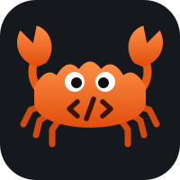

<p align="center">
  
</p>

<h1 align="center">rust-anything</h1>

<p align="center">awtory: <a href="https://github.com/erkamyaman">erKam Yaman</a></p>

<p align="center"><a href="../README.md">English</a> · <a href="README_TR.md">Türkçe</a> · <a href="README_ZH.md">简体中文</a> · <a href="README_ZH-TW.md">繁體中文</a> · <a href="README_DE.md">Deutsch</a> · <a href="README_FR.md">Français</a> · <a href="README_RU.md">Русский</a> · <a href="README_UK.md">Українська</a> · <a href="README_JA.md">日本語</a> · <a href="README_KO.md">한국어</a> · <a href="README_AZ.md">Azərbaycanca</a> · <a href="README_UZ.md">Oʻzbekcha</a> · <a href="README_KK.md">Қазақша</a> · <a href="README_KY.md">Кыргызча</a> · Türkmençe · <a href="README_TT.md">Татарча</a> · <a href="README_UG.md">ئۇيغۇرچە</a> · <a href="README_PT.md">Português</a></p>

<p align="center"><sub>Bu terjimäni jemgyýetçilik goldaýar, şonuň üçin ol <a href="../README.md">iňlisçe README</a> faýlyndan yzda galyp biler.</sub></p>

<p align="center"><em>Tutuş programmaňyzy Rust-da täzeden ýazyň. Ýoluň dowamynda onuň işleýşini saklaň.</em></p>

<p align="center"><em>CLI-ler, serwerler we kitaphanalar, bölek-bölekden, her ädimde asyl nusga bilen deňeşdirilip barlanýar.</em></p>

<p align="center">Node.js we TypeScript · Python · C · Go · Ruby · Java · PHP we C# preview ýagdaýynda</p>

<p align="center">
  <a href="https://crates.io/crates/rust-anything"></a>
  <a href="https://www.npmjs.com/package/rust-anything"></a>
  
  <a href="#haýsy-agentler-bilen-işleýär"></a>
  <a href="https://github.com/erkamyaman/rust-anything/actions/workflows/ci.yml"></a>
  <a href="../LICENSE"></a>
  <a href="https://github.com/erkamyaman/rust-anything"></a>
</p>

<p align="center">20x çenli has çalt · ýazga alnan 38,251 ýagdaý gaýtadan işledildi · 0 gabat gelmezlik · bir buýruk</p>

<p align="center">
  
</p>

**Tutuş programmaňyzy Rust-da bölek-bölekden täzeden ýazyň.** rust-anything siziň Node.js
(TypeScript/JavaScript), Python, C, Go, Ruby ýa-da Java programmaňyzyň häzir näme edýändigini ýazga
alýar, soňra Rust nusgasynyň her bölegini indiki bölege geçmezden öň şol ýazgy bilen deňeşdirip
barlaýar, programma doly arassa Rust bolýança. CLI-ler, HTTP serwerler we kitaphanalar; Rust koduny
siziň kodlaýyş agentiňiz (ýa-da özüňiz) ýazýar. Ol diňe ýazgynyň öz içine alýan zadyny tutup bilýär:
[Onuň tutup bilmeýän zatlary](#onuň-tutup-bilmeýän-zatlary) bölümine serediň. Diňe haýal bölegi
çaltlandyrmak gerekmi? Diňe şony geçiriň, bir gezekde bir hot path:

| Hakyky iş ýüki, netijeleri asyl nusga bilen birmeňzeş | Asyl nusga | rust-anything bilen |
| --- | ---: | ---: |
| x18n gapdal panelindäki gözleg, 50,000 açar (TypeScript, Node) | bir soraga 10 ms | **0.5 ms: 20x has çalt** |
| Şol gözleg brauzerde (wasm, bir akym) | 10 ms | **0.95 ms: 11.5x** |
| `slugify`, 20,000 setir (Python) | 98 ms | **17x has çalt** |
| Ruby-nyň standart kitaphanasyndaky `Shellwords.shellescape`, 50,000 baha | 88 ms | **11.8x has çalt** |
| `Slugify`, 50,000 setir (Go) | 49 ms | **4x has çalt** |
| `slugify`, 50,000 setir (Java) | 43 ms | **3x has çalt** |

4 ýadroda ölçüldi; her san üçin [`demo/`](../demo) içinde ilki netijeleriň birmeňzeşdigini barlaýan
benchmark bar. Her kiçijik funksiýa üçin Rust-y aýratyn çagyrmak adatça JIT-den *haýalrak*;
rust-anything göçürmäge degýän aýlawy tapýar we şony göçürýär.

> rust-anything garaşsyz taslama, ol Rust Project ýa-da Rust Foundation bilen baglanyşykly däl we
> olar tarapyndan goldanmaýar. "Rust" Rust Foundation-yň söwda belgisidir.

## Çalt başlangyç

Muny Claude Code, Codex, Cursor ýa-da Gemini CLI içine goýuň we gurnamagy agentiňize tabşyryň:

```text
Install rust-anything: run `cargo install rust-anything`, then `rust-anything setup`.
Tell me when to restart you.
```

Ýa-da özüňiz:

```sh
cargo install rust-anything   # from crates.io
rust-anything setup           # registers it with Claude Code, Codex, Cursor and Gemini CLI
```

Entek Rust toolchain ýokmy? macOS, Linux we Windows üçin taýýar binar faýllar her
[GitHub release](https://github.com/erkamyaman/rust-anything/releases) sahypasyna goşulan, JavaScript
taslamalary üçin bolsa `npm install -g rust-anything` şol bir binar faýly gurnaýar.

Claude Code-da ony plugin hökmünde hem gurnap bilersiňiz (MCP serwer we skill; ýokardaky CLI siziň
`PATH` içiňizde bolmaly):

```text
/plugin install rust-anything --marketplace erkamyaman/rust-anything
```

`setup` tapan her agentine MCP serweri goşýar we workflow skill-ini agentiň skill-leri okaýan ýerine
gurnaýar. Ol beýleki sazlamalaryňyzy saklaýar, ony gaýtadan işletmek howpsuz, `--remove` bolsa ony yzyna
gaýtarýar. Soňra agentiňizden, meselem, şeýle soraň:

- *"Bu CLI-ni rust-anything bilen başdan-aýak Rust-da täzeden ýaz we onuň edil şonuň ýaly işleýändigini subut et."*
- *"Bu gözleg haýal ýaly. Ony rust-anything bilen profille we hot loop-y Rust-a göçür."*
- *"rust-anything bilen `src/parser/` bukjasyny Rust-a geçirmegiň meýilnamasyny düz; birinji birligi geçir we subut et."*
- *"`rust/text-rs` içindäki Rust portuny asyl nusga bilen benchmark arkaly deňeşdir we ony çykarmalymy, aýt."*

### Haýsy agentler bilen işleýär

| Agent | `rust-anything setup` näme goşýar |
| --- | --- |
| Claude Code | `~/.claude.json` içinde MCP serwer, `~/.claude/skills/` içinde skill |
| Codex | `~/.codex/config.toml` içinde MCP serwer, `~/.codex/skills/` içinde skill |
| Cursor | `~/.cursor/mcp.json` içinde MCP serwer |
| Gemini CLI | `~/.gemini/settings.json` içinde MCP serwer |
| Islendik başga MCP müşderi | `rust-anything mcp` buýrugyny stdio serwer hökmünde el bilen goşuň ([Gurnamak](#gurnamak) bölümine serediň) |

Bar bolan faýly üýtgetmezden öň `setup` onuň nusgasyny ýanynda saklaýar (`<file>.rust-anything.bak`).

Ýa-da ädimleri özüňiz ýerine ýetiriň:

<p align="center">
  
</p>

```sh
rust-anything profile . -- node bench.mjs              # what is hot, and who calls it
rust-anything bridge . src/fuzzy.ts --batch fuzzyScore:text
# write src/port.rs (or let your agent), then:
rust-anything record rust/fuzzy-rs && rust-anything build rust/fuzzy-rs
rust-anything diff rust/fuzzy-rs                       # every recorded case must match
rust-anything bench rust/fuzzy-rs                      # faster? the verdict says
rust-anything gate rust/fuzzy-rs                       # done means this passes
```

rust-anything kody terjime etmeýär: Rust koduny siziň kodlaýyş agentiňiz (Claude Code, Codex, Cursor,
...) ýa-da özüňiz ýazýarsyňyz. rust-anything agentiň ygtybarly çaklap bilmeýän zatlaryny berýär: wagt
nirä gidýär, ilki näme we haýsy tertipde geçirmeli, galan kodyň Rust-y API-sini üýtgetmezden çagyrmagy
üçin bridge, portuň gabat gelmeli takyk özüni alyp barşy, ony çykarmagyň howpsuz ýoly we portuň haçan
taýýardygyny aýdýan gate.

## Diller

| Dil | Birlik | Bridge | Kim ýazga alýar we gaýtadan işledýär |
| --- | --- | --- | --- |
| TypeScript/JavaScript | bukja ýa-da faýl | döredilen binar wire bilen napi-rs ýa-da wasm-bindgen; klaslar we async hem bar | Node, `.ts` çeşme faýllaryny göni işledýär |
| Python | paket ýa-da modul | PyO3 (abi3), göni öwrülişik, tipli exception-lar | Python, asyl nusgany import edýär |
| C | `.c` faýly | asyl atlary we header bilen `extern "C"` funksiýalary | shared library hökmünde kompilirlenen asyl nusga, ctypes arkaly çagyrylýar, her ýagdaý üçin bir fork |
| Go | paket | tipli cgo çagyryşlary we döredilen binar wire, asyl API-li paketde | döredilen Go draýweri, aýratyn modul hökmünde gurulýar |
| Ruby | modul funksiýalaryndan ybarat faýl ýa-da bukja | asyl modullaryň aşagyndaky magnus giňeltmesi | döredilen Ruby draýweri |
| Java | `public static` usullaryndan ybarat paket | tipli JNI we döredilen binar wire, asyl usullary bolan wrapper klaslarynda | döredilen reflection draýweri |
| PHP (preview) | funksiýalardan we `public static` usullaryndan ybarat bukja | indiki nobatda: C ABI arkaly PHP FFI | häzir tutuş programmalar: `app record`, `app replay` we front door, CLI-ler we serwerler üçin (`php -S`) |
| C# (preview) | `public static` usullaryndan ybarat bukja | indiki nobatda: C ABI arkaly P/Invoke | häzir tutuş programmalar: `app record`, `app replay` we front door, CLI-ler we ASP.NET serwerleri üçin (`dotnet <app>.dll`) |

C-den başga her dil batch klaslaryny hem alýar (`--batch`): elementler serhetden bir gezek geçýär we
Rust-da galýar, her çagyryş bolsa olaryň hemmesini ähli ýadrolarda işleýär.

Dil repozitoriýden kesgitlenýär (`go.mod`, `pom.xml`, `.csproj` ýa-da `.sln`, `pyproject.toml`,
`Gemfile`, `composer.json`, `package.json`, bolmasa iň köp duş gelýän çeşme faýllary boýunça); `--lang`
ony el bilen görkezýär. Tipler çeşme kodundan alynýar: TS tipleri, Python hint-leri, C, Go, Java we C#
signaturalary, Ruby YARD tegleri, PHP tipleri we phpdoc; san hökmünde ulanylýan tipsiz parametrler san
diýlip kabul edilýär.

PHP preview ýagdaýynda: `analyze` PHP programmasyny meýilleşdirýär (Composer paketleri we PSR-4
autoloading, loose comparison we integer-iň float-a doly geçmegi ýaly töwekgelçilikler, crate-lere
laýyklaşdyrylan Composer paketleri), PHP CLI-ni ýa-da serwerini bolsa ýazga alyp, gaýtadan işledip we
Rust front door-yň arkasyna goýup bolýar. Onuň birliklerini PHP FFI arkaly Rust-a geçirmek indiki ädim
([issue #2](https://github.com/erkamyaman/rust-anything/issues/2)).

C# hem edil şeýle preview ýagdaýynda: `analyze` `.csproj` taslamalaryny we olaryň NuGet paketlerini
okaýar (crate-lere laýyklaşdyrylýar), `using` direktiwalaryny bukjalara çözýär we C#-yň başgaça
edýän zatlaryny belleýär (`decimal`, `dynamic`, LINQ-iň yza süýşürilen soraglary, `Task`, `lock`,
reflection). C# CLI-ni ýa-da ASP.NET serwerini ýazga alyp, gaýtadan işledip we Rust front door-yň
arkasyna goýup bolýar; birlikleri P/Invoke arkaly geçirmek indiki nobatda.

## Nähili işleýär

```
profile ──> analyze ──> bridge ──> record ──> port.rs ──> diff ──> bench ──> shadow ──> gate
 where the    what to     the Rust   what the    you or      every     faster?    both side   done means
 time goes    port first  crate and  original    your agent  recorded  the        by side in  this passes
                          wrapper    does        write it    case      verdict    production
```

Asyl nusga hakykatyň çeşmesi bolup galýar: `record` ony çäk ýagdaýlarynda (we siziň öz giriş
maglumatlaryňyzda) işledip, näme gaýtarýandygyny ýa-da haýsy ýalňyşlygy zyňýandygyny saklaýar; `diff`
her ýagdaýy Rust-a garşy gaýtadan işledýär; hemmesi gabat gelýänçä we `gate` geçýänçä hiç zat
çykarylmaýar. Çagyryjylar tutuş proses boýunça asyl API-ni ulanmagy dowam etdirýärler.

Tutuş programma hem şol aýlawdan birlik-birlik geçýär, tutuş programmany subut edýän çarçuwanyň içinde
([Tutuş programmany geçirmek](#tutuş-programmany-geçirmek)):

```
analyze --whole-app ──> app record ──> app front-door ──> per unit: the loop above, then app wire ──> app lift
 shape, every           what the app    Rust owns the       gate passes, so the unit answers in         pure Rust,
 dependency, the        does from the   entry point; the     Rust: replay 100%, fallback rate down      proved by
 decisions to make      outside         original answers                                                replay
```

## Aýlaw

| Ädim | Buýruk | Näme edýär |
| --- | --- | --- |
| 0. Profil | `rust-anything profile <repo> -- node bench.mjs` | Hakyky iş ýüküni diliň profilleýjisiniň aşagynda işledýär (node, cProfile, `go test` pprof, JFR, Ruby tracer): inkluziw wagt boýunça gyzgyn funksiýalar, olary çagyrýanlar we haýsy aýlawlary batch-e öwürmeli; eýýäm kompilirlenen kody belleýär (numba, Cython, JAX), ol ýerde Rust az peýda berýär |
| 1. Meýilnama | `rust-anything analyze <repo>` | Birlikler, geçiriş tertibi, `file:line` görkezilen töwekgelçilikler, her birlik üçin bridge, baglylyklaryň crate-lere laýyklygy, iň gowy ilkinji portlar; `--whole-app` giriş nokatlaryny we programmanyň şekilini, her baglylygy (import edilen ýa-da yglan edilen) öz crate-i bilen, bölekleri (biri-birini import edýän birlikler bilelikde göçýär) we maslahat berilýän jogaby bolan belgilenen kararlary goşýar |
| 2. Bridge | `rust-anything bridge <repo> <unit>` | Baglanyşyklary bolan crate (`lib.rs`, şeýle hem çeşme diliniň ýükleýän wrapper-i) we geçirmek üçin stub-lar (`port.rs`); `--batch fn:param` köp `param` bahalaryny Rust-da saklaýan klas goşýar |
| 3. Ýazga almak | `rust-anything record <crate>` | Asyl nusgany döredilen çäk ýagdaýlarynda (ASCII däl, emoji, `-0`, `NaN`, float garaşylýan ýerde int, ...) we her parametrdäki her semantik duzakda (setiriň uzynlygy we registri, alamatly bölmek, doly geçme çäkleri, float-laryň çap edilişi, map we tertipleşdiriş tertibi) işledip, `cases.jsonl` saklaýar; `--float-tolerance 1e-9` sanly kod üçin float-lara şu paýyň çäginde gabat gelmäge rugsat berýär |
| 3. Gurmak | `rust-anything build <crate>` | Rust tarapyny gurýar: `.node`, wasm paketi, Python giňeltmesi ýa-da shared library |
| 3. Deňeşdirmek | `rust-anything diff <crate>` | Ýazga alnan ýagdaýlary Rust-a garşy, asyl nusganyň çagyryjylary nähili çagyrýan bolsa, şeýle gaýtadan işledýär; gabat gelmezlikleri sanaýar |
| 3. Benchmark | `rust-anything bench <crate>` | Ýazga alnan ýagdaýlaryň asyl nusgada we Rust-da ýerine ýetiriliş wagtyny ölçeýär, bridge hem hasaba alnanda |
| 4. Shadow | `rust-anything shadow <crate>` | Ikisini hem işledýän, asyl nusganyň netijesini gaýtarýan we gabat gelmezlikler barada habar berýän drop-in çalşyryjy; `RUST_ANYTHING_MODE=old\|shadow\|new` |
| 5. Gate | `rust-anything gate <crate>` | fmt, clippy `-D warnings`, testler, `unsafe` auditi, geçirilmedik hiç zat galmazlygy, asyl nusganyň her ýalňyşlyk ýoly üçin ýazga alnan şowsuz ýagdaý, asyl nusga ýalňyşlyk gaýtarýan ýerinde `unwrap`/`expect`/`panic!` bolmazlygy (`// INFALLIBLE: <why>` diýlip bellenmedik bolsa), build, API, özüni alyp barşy |
| Agentler | `rust-anything setup` | MCP serweri (`rust-anything mcp`, her ädim tool hökmünde) we workflow skill-ini ([`skills/rust-anything/SKILL.md`](../skills/rust-anything/SKILL.md)) siziň kodlaýyş agentleriňizde hasaba alýar |

## Tutuş programmany geçirmek

Maksat: asyl nusga ýaly işleýän arassa Rust programmasy, asyl nusga bolsa salgylanma hökmünde saklanýar.
Rust koduny agentiňiz ýazýar; rust-anything işi tertipleşdirýär, karkasyny döredýär we her ädimi subut
edýär. [Whole-app skill](../skills/rust-anything/whole-app.md) agenti bu ýoldan alyp barýar, diňe
siziň kabul edip biljek kararlaryňyzdan başlap:

- **Grilling**: agent soraglary tapgyrlaýyn berýär, her soragyň maslahat berilýän jogaby bolýar, portuň
  bagly bolan her karary anyklanýança, we olaryň her birini `rust/DECISIONS.md` içine ADR hökmünde
  ýazýar, `rust/GLOSSARY.md` bolsa asyl nusganyň adalgalaryny Rust atlaryna laýyklaşdyrýar.
- **Gözleg**: fon agentleri her baglylygyň esasy çeşmelerini okaýarlar we tapan her semantik duzagy bilen
  `rust/research/<topic>.md` ýazýarlar.
- **Sessiýalaryň arasynda**: `rust/MAP.md` her birligi ýagdaýy bilen sanaýar; sessiýa işe başlamazdan öň
  bir birligi öz üstüne alýar, her checkpoint bolsa indiki sessiýa üçin `rust/HANDOFF.md` galdyrýar. Bir
  tolkundaky birlikleri subagent-ler parallel geçirip bilýärler.
- **Cutover**: agent elinden gelenini edýär we `rust/cutover.sh` ýazýar, bu diňe siziň ýerine ýetirip
  biljek ädimleriňiz (deploy, DNS, gizlin açarlar) üçin interaktiw skript, her ädimde yzyna dolanmagyň
  ýoly bar.

Grilling, gözleg we bu tejribeler
[Matt Pocock-yň skill-lerinden](https://github.com/mattpocock/skills) alnyp uýgunlaşdyryldy.

Ilki meýilnama: `rust-anything analyze . --whole-app` programmanyň şekilini (CLI, serwer ýa-da
kitaphana) we giriş nokatlaryny, her daşky baglylygy (import edilen ýa-da yglan edilen) onuň Rust
crate-i we laýyklygy bilen, geçiriş tertibini bölekler görnüşinde (biri-birini import edýän birlikler
bilelikde göçýär) we maslahat berilýän jogaby bolan belgilenen kararlary goşýar: saklanmaly birlikler,
petiklenen birlikler, crate-i ýok ýa-da diňe bölekleýin bar bolan baglylyklar.

Soňra tutuş programmany daşyndan subut ediň. `record` we `diff` bir birligi subut edýär; `app record`
we `app replay` programmany subut edýär, alty diliň islendiginde CLI-ler we serwerler üçin (programma
gara guty hökmünde seredilýär):

```sh
rust-anything app record . -- python3 cli.py          # the command that runs the original
rust-anything app replay .                            # the original must pass 100%
rust-anything app replay . --build "target/release/mytool"
```

- `app record` asyl nusgany programmanyň öz resminamalaryndaky mysallarda (onuň Markdown we shell
  faýllaryndaky `$ mytool ...` setirleri, olaryň atlandyrýan faýllary bilen), `--inputs` JSONL faýlynda
  (`{"name", "args", "stdin", "env", "files"}`) we şol ýagdaýlardan alnan semantik duzaklarda (ASCII däl
  we emoji setirleri, otrisatel bölmek we modulo, doly geçme, gaty uly we gaty kiçi float-lar, map
  tertibi, ýok faýllar) işledýär. Her ýagdaý iki gezek işledilýär; iki işledişiň arasynda tapawutlanan
  zat `[..]` wildcard-a öwrülýär. `--normalize timestamps|uuids|key-order` ýa-da `--normalize name=regex`
  normalizatorlary goşýar, olar ýagdaýlar bilen bilelikde saklanýar.
- Ýagdaýlar `rust/app-cases/` içindäki [trycmd](https://docs.rs/trycmd) faýllary: `<case>.toml` (argv,
  env, exit code), `.stdin`, `.stdout`, `.stderr`, `.in/` (giriş faýllary) we `.out/` (ýazylan
  faýllar). Olary el bilen okap we üýtgedip bilersiňiz; portuň binar faýly peýda bolanda, Rust testi
  olary `trycmd` bilen işledip bilýär.
- `app replay` islendik build-i ýagdaýlara garşy işledýär, `passed/total` çap edýär, her şowsuz ýagdaý
  üçin diff bilen `rust/app-cases/replay-report.md` ýazýar we islendik gabat gelmezlikde noldan tapawutly
  kod bilen tamamlanýar. `RUST_ANYTHING_FALLBACK_LOG` tarapyndan atlandyrylan faýla setir goşýan build
  (asyl nusga her fallback üçin bir setir), aşakdaky front door ýaly, öz fallback rate görkezijisini hem
  alýar.
- `app replay --case <name>` hasabatda berlen ady boýunça bir ýagdaýy gaýtadan işledýär: hemmesini
  täzeden işletmezden öň gabat gelmezligi düzetmek üçin çalt, gaýtalanýan aýlaw.

Soňra giriş nokadyny Rust-a göçüriň we buýruklary oňa birlik-birlik beriň:

```sh
rust-anything app front-door .                            # rust/app: every command runs the original
rust-anything app wire . textkit --command upper          # after textkit-rs passes gate
# write the glue in rust/app/src/units/textkit.rs, then:
rust-anything app wire . textkit                          # 100% again, lower fallback rate
```

- `app front-door` `rust/app` karkasyny döredýär, bu programmanyň adyny göterýän Rust binar faýly:
  ýazga alnan ýagdaýlardaky buýruklar we flaglar üçin clap parseri, bu ýerde her buýruk asyl nusgany şol
  bir argv, stdin we environment bilen işledýär we onuň çykyşyny we exit code-yny üýtgetmezden geçirýär.
  Her fallback sanalýar, şonuň üçin täze front door-y gaýtadan işletmek 100% fallback bilen 100% passed
  berýär (muny görkezmek üçin ol build edip, replay işledýär). Ol `rust/app` bukjasyny hiç haçan
  üstünden ýazmaýar: şu pursatdan başlap kod siziňki.
- `app wire <repo> <unit> --command <name>` birligiň crate-inde `gate` işledýär (ýaňy geçen bolsa,
  `--skip-gate`), ony `rust/app` içine kitaphana hökmünde goşýar, siziň ýa-da agentiňiziň doldurmagy
  üçin `src/units/<unit>.rs` faýlyny bir gezek ýazýar (argumentleri seljermek, `<crate>::port` çagyrmak,
  asyl nusganyň çap edýän zadyny çap etmek), buýruklary oňa ugrukdyrýar, soňra build edip, replay
  işledýär. `RUST_ANYTHING_UNIT_<NAME>=original` birikdirilen birligi lift-e çenli asyl nusga gaýtarýar.

Hiç bir buýrugy atlandyrmaýan argv üçin (argumentsiz çagyryş, näbelli buýruklar, usage ýalňyşlyklary)
programmanyň öz adyny buýruk hökmünde birikdiriň (`--command mytool`).

Replay 0 fallback rate bilen geçende we her birlik gate-den geçende, ony arassa Rust programmasyna
öwrüň:

```sh
rust-anything app lift .
```

- `app lift` iki şert hem ýerine ýetirilýänçä ret edýär we näme päsgel berýändigini aýdýar: henizem
  fallback-e düşýän ýagdaýlar, henizem stub ýagdaýyndaky glue kod, gate-den geçmeýän birlikler.
- Ilki nusgada fallback ýoluny we kill switch-leri aýyrýar, her birlik crate-ini `rust/app` taslamasynyň
  ýönekeý kitaphanasyna öwürýär (`cdylib`, baglanyşyklar ýa-da döredilen wrapper-ler ýok) we
  `cargo test` wagtynda `rust/app-cases` ýagdaýlaryny trycmd bilen işledýän
  `rust/app/tests/app_cases.rs` goşýar, şonuň üçin CI-e cargo-dan başga hiç zat gerek däl.
- Soňra lift barlag sanawyny ýerine ýetirýär: her birlikde we `rust/app` içinde fmt, clippy
  `-D warnings` we testler, `rust/DECISIONS.md` içinde agzalan her target gurnalan ýerinde gurulýar ýa-da
  barlanýar, işleýiş wagtynda okalýan faýllar we içine salynmadyk asset bukjalary, we arassa binar faýlda
  replay. Hemmesi geçende diňe üýtgeşmeler yzyna ýazylýar. Asyl nusga hiç haçan degilmeýär.

### Serwerler

Şol buýruklar HTTP serwerleri hem subut edýär. `--http` buýrugyň serweri işledýändigini aňladýar; ol
portuny `PORT` üýtgeýjisinden ýa-da buýrukdaky `{port}` içinden alýar (hemişe şol bir porty diňleýän
serwer üçin `--port`):

```sh
rust-anything app record . --http -- node server.js
rust-anything app replay .
rust-anything app front-door .                                    # axum: every route proxied
rust-anything app wire . api --route 'GET /users/{id}' --route '*'
rust-anything app lift .
```

- Soraglar programmanyň resminamalaryndaky `curl` setirlerinden
  (`curl -X POST -d ... http://localhost:8080/x`), `--inputs` içinden
  (`{"name", "method", "path", "headers", "body"}`) we duzaklardan alynýar: ýol segmentleri we query
  bahalary CLI argumentlerindäki duzaklar bilen çalşyrylýar, body-ler tekst we JSON duzaklary bilen,
  üstesine bir näbelli route. Her işlediş serweri täzeden başladýar we soraglary at tertibinde iberýär,
  şonuň üçin soraglaryň arasyndaky ýagdaý saklanýar.
- Ýagdaýlar `rust/app-cases/http/<case>.toml` (sorag, status we möhüm header-ler) we `<case>.body`
  (jogabyň body-si, iki işlediş tapawutlanan ýerlerde `[..]`). Date, server we her jogapda üýtgeýän
  beýleki header-ler aýrylýar; özüňize gerek däl islendik header setirini pozuň.
- Front door bu axum serweri: ol asyl nusgany öz aýratyn portunda işledýär we hiç bir birligiň jogap
  bermeýän her route-yny proksi edýär. `wire --route` axum route-laryny kabul edýär:
  `METHOD /path/{param}`, islendik usul üçin `/path`, galan hemme zat üçin `*`; glue kod route-y, onuň
  parametrlerini we soragy alýar. `lift` proksini aýyrýar; soňra HTTP ýagdaýlary CI-de `app replay`
  bilen işleýär.

### Kitaphanalar

Kitaphananyň gaýtadan işletmek üçin prosesi ýok: onuň public API-si front door bolup durýar, her birligiň
ýazga alnan ýagdaýlary bolsa subutnama bolýar.

```sh
rust-anything app front-door .        # rust/app: a Rust crate with the public API
# each unit through the loop: bridge, record, port.rs, build, diff, gate; then:
rust-anything app wire . textkit-rs   # re-exported from rust/app; the original imports its shadow
rust-anything app replay .            # every wired unit's cases; fallback = exports still in the original
rust-anything app lift .
```

- `app front-door` repozitoriýde `main` hem, serwer hem ýok bolsa (bolmasa `--library`), public API-ni
  (her birligiň eksportlaryny) tapýar we `rust/app` bukjasyny kitaphana crate-i hökmünde döredýär. Her
  birikdirilen birlik onuň moduly bolýar: `pub use textkit_rs::port as textkit;`.
- `app wire` `bridge` tarapyndan döredilen crate-i alýar, `gate` işledýär we birligiň shadow drop-in
  modulyny ýazýar: asyl paket ony birligiň ýerine import edýär, şonuň üçin onuň çagyryjylary asyl API-ni
  saklaýarlar we Rust-a ýetýärler. `RUST_ANYTHING_UNIT_<NAME>=original` birligi yzyna gaýtarýar (C:
  shadow-yň flaglary bolmazdan guruň).
- `app replay` her birikdirilen birligiň ýazga alnan ýagdaýlaryny onuň baglanyşyklary arkaly işledýär.
  Fallback rate diýip Rust-yň entek jogap bermeýän public eksportlarynyň paýyna aýdylýar: birikdirilmedik
  birlikler we `bridge`-iň çeşme dilinde galdyrýan eksportlary.
- `app lift` 0 fallback we her birligiň `gate`-den geçmegini talap edýär; ol birliklerden
  baglanyşyklary, wrapper-leri we shadow-lary aýyryp, `rust/app` bukjasyny bir arassa Rust kitaphanasy
  hökmünde galdyrýar. Ol hiç bir `port.rs` faýlyna degmeýär, şonuň üçin baglanyşyklar arkaly gabat gelen
  ýagdaýlar ony henizem beýan edýär; barlag sanawy shadow-lary henizem import edýän asyl faýllar barada
  duýduryş berýär.

Bäşisi hem MCP tool hökmünde elýeterli: `app_record`, `app_replay`, `app_front_door`, `app_wire` we
`app_lift`.

## Tejribe: x18n-iň ýadrosy

x18n ýadrosynyň API-ni üýtgetmezden göçürip bolýan ähli 29 funksiýasy rust-anything bilen geçirildi:
her gate geçýär we ýazga alnan 7,925 ýagdaý takyk gabat gelýär. Soňra `rust-anything bench` JS-den
çagyrylanda portlaryň TS-den haýalrakdygyny görkezdi, sebäbi bridge işiň özünden gymmada düşýär. Doly
hasabat: [`demo/x18n-core`](../demo/x18n-core/README.md). Bu sapak guralyň özüne goşuldy: porty
çykarmazdan öň `bench` bilen ölçäň.

## Hot paths: maglumatlary Rust-da saklamak

Her element üçin bir gezek çagyrylýan port bridge bahasyny hem her element üçin tölýär we JIT-e
utulýar. Aýlawy göçürmek ýeňýär: `profile` ony tapýar, `--batch` bolsa elementleri bir gezek kabul
edýän we funksiýany her çagyryşda olaryň hemmesine ähli ýadrolarda ýerine ýetirýän, netijeleri typed
array görnüşinde gaýtarýan klas döredýär.

```sh
rust-anything profile ../x18n -- node --experimental-strip-types $PWD/demo/x18n-search/search.ts .
# -> fuzzyScore: a quarter of the run, called per key by `matched`: batch it
rust-anything bridge ../x18n packages/core/src/fuzzy.ts --batch fuzzyScore:text
```

```js
const search = new FuzzyScoreBatch(keys)          // once
const order = search.rank(query, 0)               // per keystroke: indexes, best first
```

`port.rs` içindäki `FuzzyScoreIndex` struct-y adaty aýlawy elementleri bir gezek taýýarlaýan we özbaşdak
reýting düzüp bilýän (`rank`) aýlaw bilen çalşyrýar: ol açarlary kiçi harplar bilen, her birini nyşan
maskasy bilen saklaýar, her açardaky her ýygy duş gelýän nyşanyň ilkinji ýerleşişiniň tablisasyny
saklaýar (bir harply sorag bir sütün bolýar) we soňky soragyň gabat gelmelerini saklaýar (`s`-den soň
`se` ýazylsa, diňe `s`-iň gabat gelenleri täzeden bahalandyrylýar). x18n gapdal panelindäki 50,000
açar boýunça gözlegde, harp-harp ýazylanda, netijeler birmeňzeş bolanda:

| | Bir soraga | TS bilen deňeşdirilende |
| --- | ---: | ---: |
| TS: `map(fuzzyScore)`, filter, sort | 10 ms | 1x |
| Indeksdäki ýaly daraltmaly TS | 4.1-5.4 ms | 2x |
| Şol port, her açar üçin çagyrylýar | - | 0.2-0.4x |
| `FuzzyScoreBatch`, adaty indeks (4 ýadro) | 5.1 ms | 1.7x |
| `FuzzyScoreBatch` we `FuzzyScoreIndex` (napi, 4 ýadro) | 0.45-0.56 ms | **18-22x** |
| Şol zat wasm bilen (bir akym) | 0.95 ms | **11.5x** |

Edil şonuň ýaly daraltma edýän TS bilen deňeşdirilende-de Rust henizem 7-12x has çalt (wasm 5x).
Gaýtarylan indeksleri açarlara ýönekeý aýlaw bilen öwrüň: `Array.from(order, i => keys[i])` 20x
gymmada, 0.4 ms-e düşdi.

Her dil batch alýar we olar her çagyryş üçin portlaryň utulýan ýerlerinde-de asyl nusgadan öňe geçýär.
Şol iş 4 ýadroda, netijeler we ýalňyşlyklar birmeňzeş (benchmark-lar her demo bukjasynda):

| Dil | Iş ýüki | Asyl nusga | Her çagyryş üçin port / asyl nusga | Batch / asyl nusga |
| --- | --- | ---: | ---: | ---: |
| TS | x18n gözlegi, 50,000 açar | 10 ms | 0.2-0.4x | **20x** |
| Python | `slugify`, 20,000 setir | 98 ms | - | **17x** |
| Ruby | `slugify`, 20,000 setir | 110 ms | - | **12.7x** |
| Ruby | `shellescape` (stdlib), 50,000 garyşyk baha | 88 ms | - | **11.8x** |
| Go | `Slugify`, 50,000 setir | 49 ms | 0.93x | **4x** |
| Java | `slugify`, 50,000 setir | 43 ms | 0.68x | **3x** |

Kompilirlenen asyl nusgalar azrak utýar: her elemente gidýän iş eýýäm çalt, şonuň üçin batch ýadrolaryň
sanyna görä utýar. Batch crate-leri mimalloc bilen ýat bölýär: ulgam allocator-y bilen Go batch bir
akymdan haýal boldy. Demo: [`demo/x18n-search`](../demo/x18n-search/README.md).

## Alty dilde hakyky kod

Go-nyň `path`, Ruby-niň `shellwords`, Python-yň `colorsys`, kiçi facade-laryň arkasyndaky JDK we glibc
özüni alyp barşy: her port öz gate-inden geçýär, jemi ýazga alnan 13,010 ýagdaý. Bu synaglar
rust-anything içindäki ýalňyşlyklary tapdy we düzetdi (`serde_json` arkaly bir ULP gyşaran float-lar,
ýazga alyş wagtyndaky C çökmeleri, tipsiz koda manysyz giriş maglumatlarynyň berilmegi). Her funksiýa
üçin çagyrylanda Ruby porty Ruby-den 4.4x, Python porty bolsa CPython-dan 1.35x çalt işleýär, Go we
Java-nyň leaf funksiýalary bolsa öz dilinde has çalt bolup galýar; batch hökmünde olaryň hemmesi utýar
(ýokardaky tablisa serediň). Hasabat: [`docs/real-world-languages.md`](./real-world-languages.md).

## Mysal: x18n-den hakyky modul

[x18n](https://github.com/x18n-dev/x18n) taslamasyndaky `packages/core/src/fuzzy.ts`, iki usul bilen hem
[`demo/`](../demo) içinde geçirildi:

```sh
rust-anything analyze ../x18n                                      # fuzzy.ts: ready, wasm-bindgen (core runs in browsers)
rust-anything bridge ../x18n packages/core/src/fuzzy.ts --out demo/fuzzy-rs
rust-anything record demo/fuzzy-rs --count 2000
# write src/port.rs
rust-anything gate demo/fuzzy-rs
```

Rust `char` boýunça indeksleýän ilkinji port ýönekeý testlerden geçdi, emma `diff`-den geçmedi:

```
198/200 cases match
- fuzzyScore("b😀", "a😀b😀c"): expected {"ok":1997}, got {"ok":1998}
```

JS `indexOf` UTF-16 code unit-lerini sanaýar, şonuň üçin emoji iki ýeri eýeleýär. `demo/*/src/port.rs`
içindäki port döredilen `utf16` kömekçi funksiýalaryny ulanýar we 2000/2000 ýagdaýdan we gate-den
geçýär, napi-rs (`demo/fuzzy-napi`) hökmünde-de, wasm-bindgen (`demo/fuzzy-rs`) hökmünde-de.

rust-anything-iň tutuş x18n üçin ýazýan meýilnamasy: [`docs/examples/x18n.md`](./examples/x18n.md).

## Gurnamak

```sh
cargo install --path .
```

`record`, `diff` we `bench` asyl nusgany öz runtime-ynda işledýär: TS üçin Node 22.6+ (ol `.ts` çeşme
faýllaryny göni işledýär), Python we C üçin Python 3.9+ (ctypes), Go 1.21+, Ruby 3+, JDK 17+ (`javac` we
`java`). C üçin C kompilýatory hem gerek. wasm bridge-leri üçin goşmaça
`rustup target add wasm32-unknown-unknown` we
`cargo install wasm-bindgen-cli --version <the crate's wasm-bindgen version> --locked` gerek; `build`
takyk wersiýany görkezýär.

Agentler üçin `rust-anything setup` hemme zady hasaba alýar (Çalt başlangyç bölümine serediň). Onuň
ýerine MCP serweri bir taslama el bilen goşmak üçin (`.mcp.json`):

```json
{ "mcpServers": { "rust-anything": { "command": "rust-anything", "args": ["mcp"] } } }
```

## `bridge` näme karar berýär

- Bridge arkaly geçip bilmeýän eksportlar sebäbi görkezilip, çeşme dilinde galýar, shadow modul bolsa
  asyl nusgany gaýtadan eksport edýär. TS üçin:
  funksiýalary kabul edýän ýa-da gaýtarýan funksiýalar, generatorlar we iteratorlar, RegExp,
  `instanceof` barlaglary, generic-ler we tiplerinde (importlar, gaýtadan eksportlar we `extends` arkaly
  yzarlanýar) funksiýalar bolan bahalar. `--keep "name: reason"` has köp zady galdyrýar, meselem, `Intl`
  maglumatlaryna bagly kody.
- TS tipleri Rust tiplerine laýyklaşdyrylýar, type alias-lar importlar arkaly çözülýär, parametr tipleri
  bolsa adaty bahalardan çykarylýar; gurluşly bahalar döredilen binar wire arkaly geçýär (JSON diňe
  wire-yň modellemeýän şekilleri üçin fallback hökmünde).
- JSON `undefined`, NaN, Infinity, -0 ýa-da ýeke surrogate-leri aňladyp bilmeýär: gurluşly bahalar
  döredilen `index.cjs`-iň terjime edýän markerlerini (`{"$undefined": true}`, `{"$num": "NaN"}`,
  `{"$utf16": [...]}`) göterýär, kömekçi funksiýalar bolsa crate-iň `js.rs` faýlynda.

`record` TS çeşme faýllaryny bolşy ýaly işledýär: Node resolve hook bundler stilindäki importlaryň
yzyndan gidýär (`./errors` -> `./errors.ts`), repozitoriýde npm paketleri gurnalmadyk bolsa,
`--resolve-from` olary üpjün edýär, özgertmäni talap edýän TS (enum-lar, parameter properties) bolsa
`--experimental-transform-types` bilen täzeden synanyşylýar.

## `analyze` nämä seredýär

- Paketler (`package.json`) we çeşme faýllary; `node_modules`, build çykyşy, fixture-ler,
  playground-lar, gural konfigurasiýalary geçilýär. Vue/Svelte/Astro `<script>` bloklary importlar üçin
  seljerilýär.
- **Birlikler**: çeşme faýllarynyň bukjasy ýa-da paketiň çeşme kökündäki faýl.
- **Tolkunlar**: birligiň importlary has öňki tolkunlarda bolýar; import aýlawlary bilelikde geçirilýär.
- **Bridge**: birlige ýa-da onuň import edýän bir zadyna Node gerek bolsa, napi-rs; portatiw kod üçin
  wasm-bindgen; UI we redaktor kody üçin JS-de galdyrmak.
- **Readiness** (näçe howpsuz) we **priority** (howpsuz we degýär: aýlawlar we setirler bilen iş,
  testler, göwrüm).

| Töwekgelçilik | Agyrlygy | Mysal |
| --- | --- | --- |
| Setir offsetleri | ýokary | `slice`, `indexOf`, `matchAll`, `d` flagy: UTF-16 we UTF-8 |
| Regex sintaksisi | ýokary | lookaround, backreference, `y`: `regex` crate-inde ýok |
| Dinamik regex | ýokary | `new RegExp(userPattern)`: işleýiş wagtyndaky JS sintaksisi |
| Dinamik kod | ýokary | `eval`, `new Function`, hasaplanýan `import()` |
| Dinamik tipleşdirme | orta | `any`, `'key' in value` |
| Tertipli kolleksiýalar | orta | `Map`, `Set`, `Object.keys`: goşulyş tertibi |
| Async, generatorlar | orta | promise we generator serhetleri |
| Klas mirasy, reflection | orta | `extends`, `Proxy`, `Reflect`, `Symbol` |
| Callback görnüşli API-ler | orta | funksiýa tipli parametrler we usullar: köp gürleşýän bridge-ler |
| Exception-lar, sanlar, JSON | pes | `throw`, bit amallary, `JSON.stringify` tertibi |

## Işläp düzmek

```sh
cargo test                        # unit tests, fixture repo, record/diff/shadow loop (needs node), app record/replay per language
cargo clippy --all-targets -- -D warnings
cargo fmt
```

Dizaýn kararlary we olaryň sebäpleri: [DECISIONS.md](../DECISIONS.md).

## Täzelemek ýa-da aýyrmak

```sh
cargo install rust-anything                                    # update (Cargo)
npm install -g rust-anything@latest                            # update (npm)
rust-anything setup                                            # refresh agent settings
rust-anything setup --remove && cargo uninstall rust-anything  # remove (Cargo)
rust-anything setup --remove && npm uninstall -g rust-anything # remove (npm)
```

`setup --remove` diňe rust-anything ýazgylaryny aýyrýar; onuň saklan nusgalary
(`<file>.rust-anything.bak`) özüňiz pozýançaňyz galýar.

## Onuň tutup bilmeýän zatlary

Geçmek Rust-yň ýazga alnan her ýagdaýa gabat gelýändigini aňladýar, ondan artyk däl. Täzeden ýazmagy
bozýan zatlar adatça ýazgynyň daşynda bolýar, şonuň üçin çäkleriň nirededigini biliň:

- **Hiç kimiň ýazga almadyk giriş maglumatlary.** Döredilen ýagdaýlar, duzaklar we siziň öz `--inputs`
  maglumatlaryňyz çägi kesgitleýär. Hakyky giriş maglumatlaryny goşuň (production nusgalary, bug
  report-lar, asyl nusganyň test fixture-leri); prod-y bozýan ulanyjy girişini generator seýrek oýlap
  tapýar.
- **Regex-ler.** `regex` crate-inde lookaround ýa-da backreference ýok, hatda kompilirlenýän nusga hem
  ASCII däl tekstde `\w`, `\b`, `\d` we registre garaşsyz gabat getirmäni JS, Python ýa-da Java-dan
  başgaça işläp biler. `fancy-regex`-e geçmek ýa-da nusgany täzeden ýazmak ýazga alnan her ýagdaýdan
  geçip, ýöne türkçe nokatsyz `ı` ýa-da zero-width joiner-de barybir tapawutlanyp biler. `record` regex
  ulanýan faýldaky her funksiýa regex duzaklaryny (ýokarkylar, Kelwin belgisi, uzyn s, arap-hindi
  sanlary, setir aýyryjylary, soňky sigma) goşýar, ýöne hakyky nusgalaryňyzy hakyky tekst bilen fuzz
  ediň.
- **Işledişleriň arasynda üýtgeýän zatlar.** `record` asyl nusgany iki gezek işledip, nämäniň
  tapawutlanandygyny tertipleşdirýär: üýtgän bahalar (wagt, id) wildcard-a öwrülýär; başga tertipde gelen
  birmeňzeş setirler (hash map-lar, concurrency) islendik tertipde deňeşdirilýär, şonuň üçin port edil
  şol setirleri çykarmaly; setirleriň sany tapawutlansa, islendik zada gabat gelýän `...` bolýar.
  `record` her görnüşi sanaýar: olaryň her birine serediň, sebäbi hash tertibi ýa-da concurrency
  tapawudy portda hakykatdan üýtgäp biljek zat.
- **Float-lar.** Sany tekste formatlamak diller arasynda tapawutlanýar (`1e21`, `-0`, sanlaryň sany).
  Duzaklar şol bahalary öz içine alýar we olar takyk gabat gelmeli; `--float-tolerance` diňe
  tegelekleme tapawudyny bagyşlaýar, formatlamany hiç haçan bagyşlamaýar.
- **Çykyşda ýok zatlar.** Wagt, ýat, ýük astyndaky concurrency we stdout, stderr, exit code, ýazylan
  faýllar we HTTP jogaplaryndan başga goşmaça täsirler (tor çagyryşlary, maglumat binýatlary, signallar)
  deňeşdirilmeýär.
- **Başga platformalar.** Ýazgy diňe ony işleden maşyndaky özüni alyp barşy subut edýär. Netijeleri tip
  ölçeglerine, endianness-e ýa-da kompilýatora bagly C kody target ulgamda başgaça işläp biler; şonuň
  üçin `analyze` hardware-e ýakyn C koduny C-de galdyrýar.

## Köp soralýan soraglar

**Ol meniň kodumy awtomatik täzeden ýazýarmy?** Ýok. Ol näme göçürmelidigini tapýar, bridge döredýär,
asyl nusganyň näme edýändigini ýazga alýar we Rust-y oňa garşy barlaýar. Rust koduny `port.rs` içinde
siz ýa-da agentiňiz ýazýar; onuň dogrudygyny `diff` we `gate` karar berýär.

**Programmamyň API-si üýtgärmi?** Ýok. Çagyryjylar şol bir funksiýalary import edýärler (ýa-da shadow
moduly, ol siz ynam toplaýançaňyz ikisini hem işledip, asyl nusganyň netijesini gaýtarýar).

**Rust hemişe has çaltmy?** Ýok, we rust-anything muny açyk aýdýar. Her element üçin bir gezek
çagyrylýan kiçi funksiýa Rust-da köplenç haýalrak, sebäbi her çagyryş bridge arkaly geçýär; V8, JVM we
Go şeýle funksiýalary nanosekuntlarda ýerine ýetirýär. `profile` onuň daşyndaky aýlawy tapýar,
`--batch` tutuş aýlawy göçürýär, `bench` bolsa çykarmazdan öň netije berýär. numba, Cython ýa-da JAX
arkaly eýýäm kompilirlenen kod hem maşyn kody hökmünde işleýär: `profile` we `analyze` ony belleýär,
sebäbi ony geçirmek tizlige az peýda berýär.

**Meniň kodum sanly; float-lar takyk gabat gelermi?** Köplenç ýok: amallaryň tertibi, fused
multiply-add we matematiki kitaphana kompilýatorlaryň arasynda tapawutlanýar. `--float-tolerance 1e-9`
bilen ýazga alyň (`record` ýa-da `app record`), şonda float-lar uly bahanyň şu paýynyň çäginde gabat
gelýär (1-den aşakda bolsa, absolýut görnüşde). Bitin sanlar, tekst we gurluş barybir takyk gabat
gelmeli.

**Ol diňe APK, JAR ýa-da .exe görnüşinde bar bolan programmany geçirip bilýärmi?** Ýok. Ol çeşme koduny
geçirýär: funksiýalary seljerýär, olaryň her biriniň näme edýändigini ýazga alýar we Rust-y işläp
duran asyl nusga garşy barlaýar. Kompilirlenen programmada bularyň hiç biri ýok, we `analyze` muny
aýdýar. Binar faýlyň görünýän özüni alyp barşyna seredip täze Rust programmasyny ýazmak başga taslama.

**Synagdan geçen C koduny geçirmelimi?** Köplenç ýok, we `analyze` nirededigini aýdýar. Hardware
registrleri bilen işleýän, kompilýatoryň tip ölçeglerine ýa-da ýat ýerleşişine daýanýan ýa-da inline
assembly ulanýan C kody (`volatile`, bitfield-ler, packed struct-lar, `__asm__`, salga öwrülen bitin
sanlar) "keep in C" diýlip bellenýär: siziň maşynyňyzdaky ýazgy target barada hiç zady subut etmeýär,
durnukly draýwer ýa-da firmware kody bolsa täzeden ýazmakdan az utýar. Onuň daşyndaky portatiw logika
(parsing, protokollar, maglumatlary işlemek) gowy göçýär.

**Ol meniň Electron programmamy geçirip bilýärmi?** Logikasyny, hawa; penjireler web sahypalar bolup
galýar. `analyze --whole-app` Electron-y anyklaýar we main prosesi bölek-bölekden meýilleşdirýär,
renderer bolsa öňküsi ýaly galýar. UI-ni Tauri-ä göçürmek (Rust backend-däki şol bir web UI) logika
Rust-a geçenden soňky aýratyn ädim.

**C#, Kotlin ýa-da Swift barada näme?** C# preview ýagdaýynda ([Diller](#diller) bölümine serediň);
Kotlin we Swift entek goldanmaýar. Her dile parser, recorder, bridge we replay draýweri gerek, hemmesi
başdan-aýak synagdan geçirilen. Özüňize gerek dil üçin issue açyň (ýa-da bar bolanyna ses beriň).

**Rust kody asyl nusgadan has uly bolup gitmezmi?** Bolmaly däl. `gate` portuň setir sanyny asyl
nusgadaky bilen deňeşdirýär we 3x-den geçse (üstesine importlar we signaturalar üçin 50 setir) şowsuz
tamamlanýar: bu adatça crate-iň eýýäm edýän zadyny el bilen ýazmagy ýa-da ýagdaýlary birme-bir işlemegi
aňladýar. `analyze` ulanmaly crate-leri sanaýar.

**Bölek-bölekden geçirmek Rust-y köne programmanyň dizaýnyna baglap goýmazmy?** Ikisi ýanaşyk işleýän
wagtynda diňe. Ýazgylar özüni alyp barşy programmanyň içki gurluşyndan däl-de, onuň serhetlerinden
barlaýar (CLI-niň çykyşy, serweriň jogaplary, modulyň eksport edilen funksiýalary). Birlikler henizem
bridge arkaly geçýärkä köne gurluşy gaýtalaň; `app lift` asyl nusgany aýyrandan soň Rust-y erkin
täzeden gurnaň, `app replay` bolsa özüni alyp barşy barybir subut edýär. Hiç zat asyl nusga yzyna
çagyryş hem etmeýär: front door ony aýratyn proses hökmünde işledýär (ýa-da oňa HTTP ugradýar), bridge
bilen birikdirilen birlikleri asyl nusga çagyrýar, tersine hiç haçan däl, callback-ler bolsa çeşme
dilinde galýar.

**Meniň kodum maşynymdan çykyp gidýärmi?** Ýok: rust-anything ýerli işleýär we kodyňyzyň hiç bir bölegini
hiç ýere ibermeýär. Cargo crate-leri adatdakysy ýaly ýükleýär, agentiňiziň model üpjünçisi bolsa
agentiňiziň oňa iberýän zadyny öz syýasatyna laýyklykda görýär.

**Näme gurnalmaly?** Rust we siziň geçirýän diliňiziň runtime-y ([Gurnamak](#gurnamak) bölümine
serediň).

**Bir zat döwüldi.** Buýruk, onuň çykyşy we platformaňyz görkezilen issue açyň.

## Hemaýatkärler

rust-anything mugt we açyk çeşmeli taslama. Eger ol işiňize kömek edýän bolsa, oňa hemaýatkär bolmagy
göz öňünde tutuň. Siziň goldawyňyz işläp düzmegiň dowam etmegine kömek edýär.

<p>
  <a href="https://github.com/sponsors/erkamyaman"></a>
</p>

### Kompaniýa hemaýatkärleri

<!-- prettier-ignore-start -->
<a href="https://coderabbit.ai"></a>
<!-- prettier-ignore-end -->

### Şahsy hemaýatkärler

<!-- sponsors -->
<!-- prettier-ignore-start -->
<table>
  <tbody>
    <tr>
      <td align="center" valign="top" width="14.28%"><a href="https://github.com/aliyilmazco"><br /><sub><b>Ali Yilmaz</b></sub></a></td>
    </tr>
  </tbody>
</table>
<!-- prettier-ignore-end -->
<!-- /sponsors -->

## Goşant goşmak

Issue-lar we pull request-ler hoş görülýär; [CONTRIBUTING.md](../CONTRIBUTING.md) gurşawy sazlamagy,
testleriň nirede ýerleşýändigini we täze dili nähili goşmalydygyny düşündirýär. Dizaýn kararlary we
olaryň sebäpleri [DECISIONS.md](../DECISIONS.md) içinde. Hakyky portlaryň tejribe mysallary aýratyn
hoş görülýär. Howpsuzlyk meseleleri barada gizlin habar beriň ([SECURITY.md](../SECURITY.md)), şeýle
hem [özüňi alyp barş kodeksine](../CODE_OF_CONDUCT.md) serediň.

## Ygtyýarnama

[MIT](../LICENSE) © [Erkam Yaman](https://github.com/erkamyaman). Repozitoriýiňizdäki portlar we döredilen kod siziňki.
